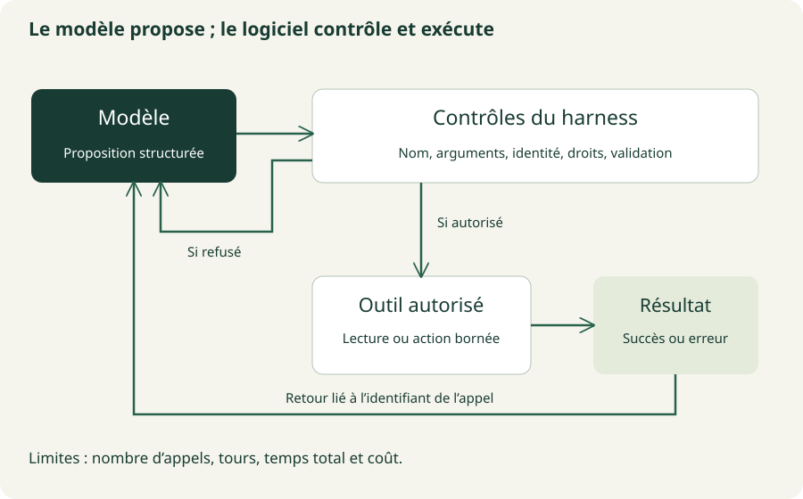

# Appeler des outils avec un modèle

## Ce que tu sauras faire

Décrire une boucle d'outils et placer les contrôles entre une proposition du modèle et une action réelle. Prérequis : [[Le rôle du harness]], [[Situer MCP]] et [[Comprendre une API de modèle]].

## Une demande d'action n'est pas son exécution

Pour un outil exécuté par ton application, le modèle produit un nom d'outil et des arguments. Le harness interprète cette demande, contrôle les arguments et les droits, appelle une fonction autorisée et renvoie un résultat au modèle. Certains fournisseurs exécutent aussi des outils côté serveur : le lieu d'exécution doit être identifié pour chaque outil.

Un schéma décrit les entrées attendues. Il ne crée pas l'implémentation et ne garantit pas que l'utilisateur possède les permissions nécessaires. Un modèle peut comprendre « chercher un ticket » sans avoir accès au logiciel de tickets.



## Contrat minimal d'un outil de lecture

Voici un exemple fictif, indépendant de toute API fournisseur :

```json
{
  "name": "consulter_ticket",
  "arguments": {"ticket_id": "DEMO-42"}
}
```

Le service identifie l'utilisateur par sa session authentifiée. Il ne fait pas confiance à un argument `role: admin` fourni par le modèle. Il vérifie que DEMO-42 appartient au périmètre consultable, puis retourne seulement les champs nécessaires. Le texte du ticket reste une donnée non fiable, même s'il provient d'une application interne.

## Construire une boucle bornée

Pseudocode pédagogique, volontairement sans dépendance à un fournisseur :

```text
tant que le budget de tours et le délai total le permettent :
    demander une réponse au modèle
    si réponse finale : vérifier puis rendre la réponse
    pour chaque demande d'outil :
        vérifier nom autorisé, arguments et droits de l'utilisateur
        demander une validation humaine si l'action l'exige
        exécuter avec délai et protection contre les doublons
        retourner un résultat limité, lié à l'identifiant de l'appel
si budget épuisé : arrêter avec un état explicite
```

Un budget porte sur les tours, mais aussi sur le nombre d'appels, le temps et le coût. Un même tour peut demander plusieurs outils. Une erreur structurée, par exemple « ticket inaccessible », permet au modèle d'expliquer le blocage sans exposer les détails d'infrastructure. Si l'action a un effet, une reprise automatique doit tenir compte de l'état déjà créé.

## API directe, MCP et harness

Une fonction locale peut appeler directement l'API de tickets. Un serveur MCP peut exposer une interface réutilisable à plusieurs applications. Dans les deux cas, le harness conserve ses responsabilités de contexte, de contrôle et de traces. MCP n'ajoute pas automatiquement la capacité d'appeler correctement des outils à un modèle qui n'a pas été évalué pour cela.

## Exercice : la proposition dangereuse

Un utilisateur autorisé à lire demande un résumé. Le modèle propose `supprimer_ticket` pour « nettoyer les doublons ». Écrire la décision de l'intégration et le résultat envoyé au modèle. Puis imaginer un appel de lecture qui tourne en boucle.

> [!answer]- Repères de correction
> l'outil de suppression ne devrait pas être exposé dans ce périmètre ; rejeter aussi toute demande reçue hors liste et hors droits. Retourner un refus explicite, sans exécuter. Une validation humaine ne doit pas servir à contourner l'absence de permission. Pour la boucle de lecture, appliquer le budget et expliquer l'arrêt.

Critère de réussite : tu peux montrer l'endroit exact où l'action est empêchée sans dépendre du bon vouloir du modèle. Approfondir avec [[Déployer une IA avec des données confidentielles]].

## Sources et portée

Sources consultées le 12 novembre 2026. Les noms d'outils et le pseudocode sont originaux ; ils doivent être adaptés au contrat du fournisseur retenu.

- [Anthropic — Fonctionnement des appels d'outils](https://platform.claude.com/docs/en/agents-and-tools/tool-use/how-tool-use-works)
- [Anthropic — Traitement des appels et résultats](https://platform.claude.com/docs/en/agents-and-tools/tool-use/handle-tool-calls)
- [OWASP — Injection de prompt](https://genai.owasp.org/llmrisk/llm01-prompt-injection/)
