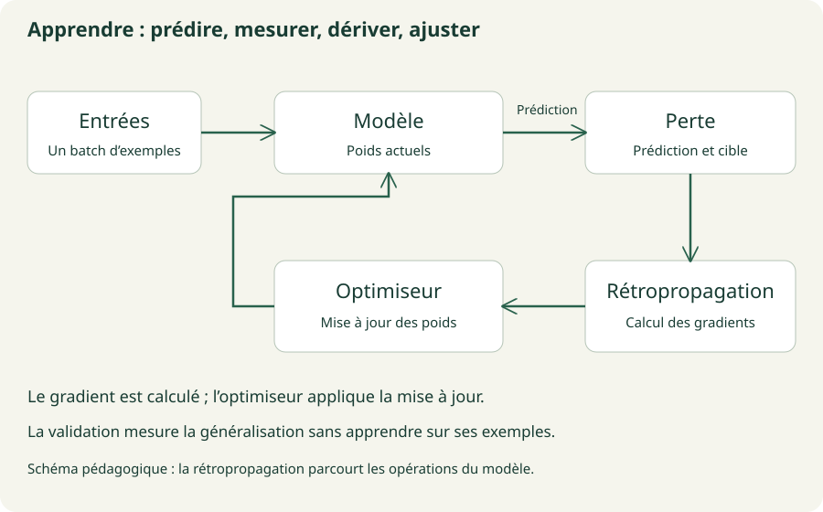

# Apprentissage gradients et surapprentissage

## Ce que tu sauras faire

Expliquer comment un entraînement modifie les paramètres, lire une courbe de perte et repérer une fuite entre entraînement et test. Prérequis : [[Vecteurs matrices et similarité]] et [[Évaluer une intégration]].

## Apprendre une fonction à partir d'exemples

En apprentissage supervisé, on associe une entrée à une cible : un message et sa catégorie, par exemple. Une fonction de perte mesure un écart entre prédiction et cible. L'optimiseur ajuste les paramètres pour réduire cette perte sur les exemples d'entraînement. La perte est un instrument mathématique ; elle ne représente pas automatiquement le coût métier d'une erreur.

Un gradient indique les dérivées de la perte par rapport aux paramètres. La rétropropagation calcule ces dérivées en parcourant les opérations du modèle avec la règle de dérivation en chaîne. L'optimiseur utilise ensuite les gradients ; calculer un gradient et mettre à jour les poids sont deux étapes différentes.

## Un calcul à la main

> [!formula] Descente de gradient — un paramètre
> w suivant = w actuel − η × ∂L/∂w

Le symbole *η* (êta) est le pas d'apprentissage ; ∂L/∂w est la dérivée de la perte par rapport au paramètre *w*.

Prenons y = w × x, avec x = 2, une cible de 6 et une perte L = (2w − 6)². On part de w = 1 et d'un pas η = 0,1.

| Étape | Calcul | Résultat |
| --- | --- | --- |
| Prédiction initiale | 1 × 2 | 2 |
| Perte initiale | (2 − 6)² | 16 |
| Dérivée de la perte | 4 × (2w − 6), avec w = 1 | −16 |
| Mise à jour de w | 1 − 0,1 × (−16) | **2,6** |
| Nouvelle prédiction | 2,6 × 2 | 5,2 |
| Nouvelle perte | (5,2 − 6)² | **0,64** |

Cet exemple convexe à un paramètre n'est pas un modèle réaliste de toute la difficulté d'un LLM. Il montre le rôle du signe et du pas : un pas trop grand peut faire dépasser la zone utile et déstabiliser l'entraînement.

Un batch est un groupe d'exemples traité pour estimer une mise à jour. Une époque correspond à un passage sur le jeu d'entraînement dans l'organisation classique. Plusieurs passages peuvent améliorer l'ajustement sans améliorer la généralisation.

## Trois ensembles, trois usages

- **Entraînement** : sert à apprendre les paramètres.
- **Validation** : sert à comparer les réglages et choisir un point d'arrêt.
- **Test** : sert à estimer les performances après les décisions de conception.

Le surapprentissage apparaît lorsque le modèle s'adapte trop aux particularités des exemples vus. Une perte d'entraînement qui baisse alors que la perte de validation remonte est un signal à examiner, pas une raison d'entraîner plus longtemps automatiquement. Régularisation, qualité des données, capacité du modèle et arrêt anticipé sont des pistes différentes.

## Les fuites peuvent rendre les chiffres trompeurs

Séparer des lignes au hasard ne suffit pas si plusieurs lignes viennent du même dossier ou sont des doublons. Une information connue seulement après la décision ne doit pas devenir une entrée d'un système censé prédire avant cette décision. Pour un processus temporel, une séparation chronologique peut être plus représentative qu'un mélange aléatoire.

L'apprentissage autosupervisé construit ses cibles depuis les données elles-mêmes, par exemple en prédisant un élément masqué. Cela ne signifie ni absence de données ni absence de fonction de perte. Voir [[Comprendre JEPA et la prédiction de représentations]].

## Exercice : un score trop beau

Un lot contient dix reformulations de chacun de 100 tickets. Une séparation aléatoire par ligne donne 99 % de réussite. Une séparation par ticket d'origine donne 77 %. Quel résultat est le plus pertinent pour traiter de nouveaux tickets, et que vérifier ensuite ?

> [!answer]- Repères de correction
> Le second protocole réduit la fuite liée aux variantes d'un même ticket. Il faut encore vérifier les doublons entre tickets, les dates, les catégories et la représentativité. Le premier résultat mesure en partie la reconnaissance de situations déjà vues. Aucun des deux pourcentages ne valide seul une mise en production.

## Sources et portée

Sources consultées le 12 novembre 2026. Le calcul et les scores sont fictifs.

- [PyTorch — Différentiation automatique](https://docs.pytorch.org/tutorials/beginner/basics/autogradqs_tutorial.html)
- [PyTorch — Optimisation des paramètres](https://docs.pytorch.org/tutorials/beginner/basics/optimization_tutorial.html)
- [scikit-learn — Validation croisée](https://scikit-learn.org/stable/modules/cross_validation.html)
- [scikit-learn — Fuites de données et erreurs courantes](https://scikit-learn.org/stable/common_pitfalls.html)
