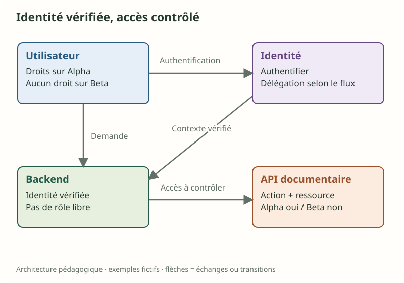

# Authentification : clés, OAuth et comptes de service

Prérequis : [[HTTP, TLS, proxy et reverse proxy]] ; [[Déployer une IA avec des données confidentielles]].

## Ce que tu sauras faire

- Distinguer authentification, autorisation et identité de service.
- Situer une clé API et un jeton OAuth.
- Empêcher un assistant de dépasser les droits de la personne qui l'utilise.

> [!abstract] À retenir
> « Qui appelle ? » et « Que peut-il faire sur cette ressource ? » sont deux questions différentes. Un secret valide ne donne pas tous les droits.

## Les identités d'une intégration

| Terme | Ce qu'il représente | Ce qu'il ne garantit pas |
| --- | --- | --- |
| Authentification | Vérification d'une identité ou d'un justificatif | Droit de lire tout document |
| Autorisation | Décision d'accès à une action et une ressource | Exactitude du modèle |
| Clé API | Secret présenté selon le contrat du service | Délégation précise d'un utilisateur |
| Compte de service | Identité dédiée à un logiciel | Exemption des règles d'accès |
| Jeton d'accès OAuth | Justificatif permettant un accès borné | Identité utilisateur universelle |

OAuth organise l'autorisation déléguée et l'obtention de jetons. **OpenID Connect** ajoute une couche d'identité au-dessus d'OAuth 2.0. Ne pas utiliser indistinctement un jeton d'identité et un jeton destiné à appeler une API : leurs destinataires et usages diffèrent.

## Délégation utilisateur ou tâche de service ?

Pour une action au nom d'une personne, une délégation peut limiter l'accès à son périmètre. Pour une tâche technique autonome, une identité de service peut être appropriée. Le flux OAuth dépend du type de client et du fournisseur ; les bonnes pratiques de sécurité recommandent notamment de protéger les flux par code avec PKCE et d'éviter les anciens flux dépréciés.

> [!warning] La clé du backend ne doit pas devenir la clé du navigateur
> Un secret dans le JavaScript envoyé au navigateur est accessible à l'utilisateur. Conserver les secrets de service dans l'environnement serveur prévu, et ne pas les inclure dans les prompts, les captures ou les traces.

Les scopes peuvent borner des catégories d'actions. Ils ne remplacent pas nécessairement un contrôle d'accès sur chaque objet. Un jeton autorisant la recherche ne signifie pas que tous les documents du moteur doivent être retournés.

## Exemple : un assistant documentaire interne

Une personne peut lire le projet Alpha mais pas le projet Beta. Le backend possède un compte technique capable d'interroger l'index global. Si la recherche ignore l'identité utilisateur, le modèle peut recevoir un extrait Beta même si sa réponse finale ne le cite pas.

> [!example] Contrôle attendu
> Le backend transmet un contexte d'identité vérifié. La couche de recherche applique les droits avant de livrer des passages au modèle. Une autorisation est revérifiée au moment de l'accès ; elle n'est pas déduite d'un nom de projet fourni librement dans le prompt.

> [!tip] Méthode de revue
> Pour chaque appel : noter l'identité effective, le destinataire du jeton, l'action permise, les ressources autorisées, l'expiration et la procédure de révocation. Tester aussi le refus avec un compte aux droits limités.

Voir [[Déployer une IA avec des données confidentielles]] et [[Distinguer outils MCP skills et plugins]] : installer une extension n'autorise pas automatiquement ses opérations.

## Exercice : l'agent trop bien équipé

L'assistant d'un lecteur utilise un compte technique administrateur. Il reçoit une demande de synthèse du projet Alpha, mais la recherche retourne aussi Beta. Le développeur propose une consigne : « Ne mentionne jamais Beta ».

- Où se situe la fuite ?
- Quel contrôle déplacer avant la génération ?
- Quel test effectuer après la correction ?

> [!answer]- Repères de correction
> **Fuite** : les extraits Beta ont déjà quitté leur périmètre autorisé lorsqu'ils sont transmis à ce traitement pour le lecteur. Masquer leur mention dans la réponse ne corrige pas l'accès.
>
> **Contrôle** : appliquer les permissions documentaires à partir d'une identité vérifiée avant de retourner les passages. Réduire aussi les privilèges du compte technique selon les besoins. Le contrôle doit résister à un nom de projet falsifié dans la demande.
>
> **Test** : une personne Alpha recherche des termes présents seulement dans Beta ; aucun extrait Beta n'entre dans le contexte. Tester ensuite une personne autorisée sur Beta pour vérifier que le contrôle ne bloque pas les accès légitimes. Vérifier également les caches et les traces.

## Sources et portée

Sources consultées le 12 novembre 2026. Introduction conceptuelle ; la configuration doit suivre le fournisseur d'identité et les politiques de l'organisation.

- [IETF — Cadre OAuth 2.0](https://www.rfc-editor.org/rfc/rfc6749.html)
- [IETF — Bonnes pratiques de sécurité OAuth, RFC 9700](https://www.rfc-editor.org/rfc/rfc9700.html)
- [OpenID Foundation — OpenID Connect Core](https://openid.net/specs/openid-connect-core-1_0.html)
