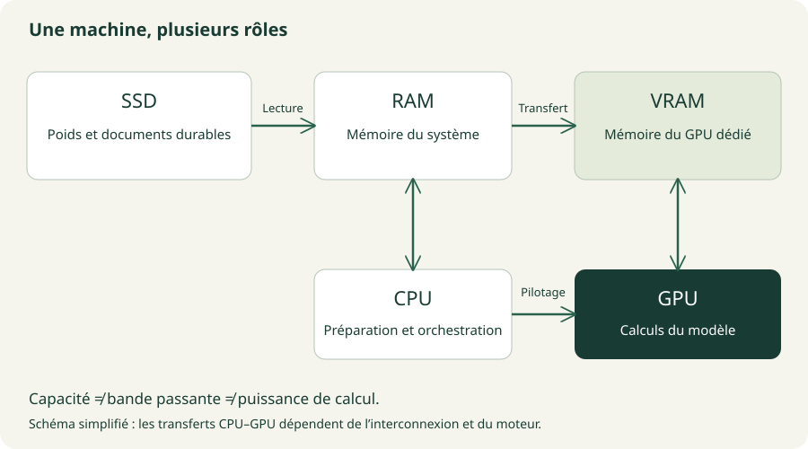

# CPU GPU RAM et VRAM

## Ce que tu sauras faire

Placer les composants d'un ordinateur dans un système d'inférence et expliquer pourquoi « beaucoup de mémoire » ne signifie pas « réponses rapides ». Prérequis : [[Du modèle au système]].

## Calculer, stocker et déplacer

Le CPU exécute le système d'exploitation et de nombreuses tâches générales : lire un fichier, préparer une requête, appliquer une règle, orchestrer les services. Il peut aussi exécuter des modèles. Le GPU possède des ressources adaptées à de nombreux calculs parallèles, notamment les opérations sur matrices des réseaux neuronaux. Son efficacité dépend du travail fourni et des logiciels compatibles.

La RAM est la mémoire de travail du système. La VRAM est la mémoire d'un GPU dédié. Le SSD conserve durablement les fichiers : poids, documents et programmes. Charger un modèle consiste à placer ses données dans la mémoire utilisée pour les calculs ; le fichier sur disque ne suffit pas à l'exécuter.

Sur une carte dédiée, RAM et VRAM sont des espaces physiques distincts. La mémoire unifiée de certaines plateformes change cette organisation ; elle ne supprime ni les limites de capacité, ni le coût des accès mémoire. Il faut lire l'architecture de la machine plutôt qu'additionner des chiffres commerciaux.

## Trois limites différentes

- **Capacité** : les poids et les données de travail tiennent-ils en mémoire ?
- **Bande passante** : combien de données peuvent être déplacées par seconde ?
- **Puissance de calcul** : combien d'opérations compatibles peut-on effectuer par seconde ?

Une application peut attendre des données alors que certaines unités de calcul restent disponibles. Les performances dépendent aussi du format numérique, des noyaux logiciels, du nombre de requêtes et de la longueur du contexte. Comparer uniquement des TOPS ou des TFLOPS ne suffit pas : ces mesures n'ont de sens qu'avec leurs hypothèses de précision et de calcul.

Un NPU est un accélérateur destiné aux opérations de réseaux neuronaux. Sa présence ne signifie pas que n'importe quel LLM y tourne. Le support du modèle, des opérateurs et de l'environnement logiciel est déterminant. CPU, GPU et NPU sont des rôles matériels ; le choix réel se vérifie avec un moteur d'exécution compatible.

## Exemple de laboratoire personnel

Pour une machine avec 32 Go de RAM et une carte de 12 Go de VRAM, le budget GPU reste 12 Go avant les autres consommations. Il ne devient pas 44 Go de VRAM. Un moteur peut déplacer des poids ou des caches vers la RAM : c'est de l'offload, avec des transferts ou du calcul CPU qui peuvent ralentir l'ensemble.

Un serveur CPU doté de 200 Go de RAM peut accueillir de grands volumes en mémoire. Cela ne prédit pas son débit de génération. Il peut aussi être utile pour héberger le backend, préparer les documents et servir un index pendant qu'une API distincte assure l'inférence. Voir [[Comprendre une API de modèle]]. Ces exemples décrivent des possibilités, pas des performances mesurées sur tes machines.

## Exercice : répartir les rôles

Dessiner une application documentaire avec quatre tâches : stockage des PDF, extraction de texte, recherche des passages et génération. Pour chaque tâche, indiquer stockage durable, mémoire de travail et processeur possible. Proposer ensuite une variante où seule la génération est distante.

> [!answer]- Repères de correction
> les PDF persistent sur disque ; extraction et index utilisent de la RAM et du calcul ; la génération peut utiliser le GPU local ou un service autorisé. Une recherche vectorielle n'exige pas systématiquement un GPU. La variante distante transmet les passages sélectionnés : le trajet doit être explicité dans [[Déployer une IA avec des données confidentielles]].

## Sources et portée

Sources consultées le 12 novembre 2026. Le schéma représente une machine à GPU dédié ; il ne décrit pas toutes les architectures.

- [NVIDIA — GPU Performance Background](https://docs.nvidia.com/deeplearning/performance/dl-performance-gpu-background/index.html)
- [NVIDIA — Partage mémoire CPU-GPU et offload](https://developer.nvidia.com/blog/accelerate-large-scale-llm-inference-and-kv-cache-offload-with-cpu-gpu-memory-sharing)
- [Intel — Pilote et environnement logiciel du NPU](https://github.com/intel/linux-npu-driver)

Suite : [[Estimer la mémoire et comprendre la quantification]].
