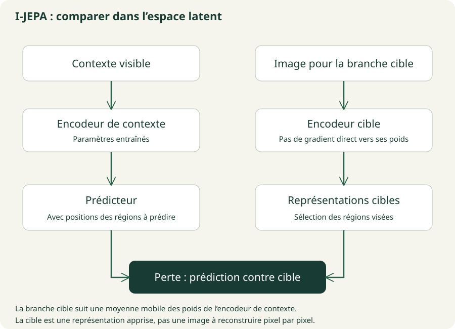

# Comprendre JEPA et la prédiction de représentations

## Ce que tu sauras faire

Expliquer ce que JEPA prédit, distinguer les exemples image et vidéo et reconnaître les limites d'une démonstration de recherche. Prérequis : [[Apprentissage gradients et surapprentissage]] et [[Comprendre le Transformer et son attention]].

## Prédire dans un espace de représentations

JEPA signifie Joint-Embedding Predictive Architecture. L'idée générale est de prédire la représentation d'une partie non observée à partir d'un contexte observé. La cible est une représentation interne apprise ; elle n'est pas nécessairement du texte, une classe ou une reconstruction exacte de pixels.

Dans I-JEPA, consacré aux images, un encodeur traite le contexte visible et un prédicteur cherche les représentations de régions cibles. Un encodeur cible produit les représentations à atteindre. Dans cette méthode, sa mise à jour repose sur une moyenne mobile des paramètres de l'encodeur de contexte, et non sur la même rétropropagation directe à travers la cible. Le choix des masques et l'organisation de l'entraînement comptent pour apprendre des représentations utiles.

Cette distinction évite un raccourci : « il prédit ce qui manque » ne signifie pas forcément « il dessine la partie manquante de l'image ».

## Image, vidéo et action ne sont pas identiques

Les travaux V-JEPA transposent cette famille d'idées aux vidéos, avec des informations spatiales et temporelles. Le travail V-JEPA 2 publié en 2025 étudie des représentations vidéo et une adaptation conditionnée par les actions pour la planification robotique. L'ajout d'interactions et d'un mécanisme de planification est une étape distincte de la simple observation de vidéos.

Un encodeur visuel ne devient pas automatiquement un assistant conversationnel. Il faut un composant adapté à la sortie voulue : classificateur, rapprochement avec un modèle de langage, planificateur, etc. Le terme « modèle du monde » doit être rattaché à des tâches et à des résultats précis, pas interprété comme une compréhension universelle démontrée.

## JEPA et Transformer ne sont pas deux cases exclusives

Transformer décrit une famille de blocs de calcul. JEPA décrit une approche d'apprentissage et de prédiction de représentations. Des travaux JEPA utilisent des Vision Transformers. De même, opposer « JEPA » et « tous les LLM » sans préciser les entrées, les objectifs et les composants mélange plusieurs niveaux de description.

Pour comprendre une publication, chercher : quelles données sont observées, ce qui est masqué, la cible calculée, la fonction de perte, ce qui est entraîné et le protocole d'évaluation. Une performance sur un benchmark donné ne répond pas à toutes les questions d'intégration.

## Exemple industriel fictif

Pour repérer une opération inhabituelle dans une vidéo d'assemblage, on pourrait tester des représentations vidéo puis un détecteur adapté. Il resterait à définir l'anomalie, collecter des exemples autorisés, traiter les variations de caméra et mesurer les faux positifs. Utiliser un encodeur issu de JEPA serait une hypothèse à comparer, pas la preuve que le problème est résolu.

## Exercice : choisir la sortie attendue

Un responsable demande « un JEPA qui lit une vidéo et rédige un rapport de conformité ». Séparer au moins trois fonctions à mettre en place et préciser ce qui manque pour évaluer la solution.

> [!answer]- Repères de correction
> Il faut au minimum percevoir et représenter la vidéo, appliquer des critères de conformité, puis produire un rapport relié aux observations. Une architecture peut fusionner certains composants, mais ces responsabilités restent à tester. Il manque les règles, les annotations de référence, les conditions de capture et les mesures d'erreur. Un encodeur seul ne fournit pas toutes ces fonctions.

## Sources et portée

Sources consultées le 12 novembre 2026. Ce cours explique des travaux identifiés de 2023 et 2025, sans prétendre dresser le classement des modèles disponibles.

- [Assran et al. — I-JEPA](https://arxiv.org/abs/2301.08243)
- [Meta — Implémentation officielle I-JEPA](https://github.com/facebookresearch/ijepa)
- [Assran et al. — V-JEPA 2](https://arxiv.org/abs/2506.09985)
