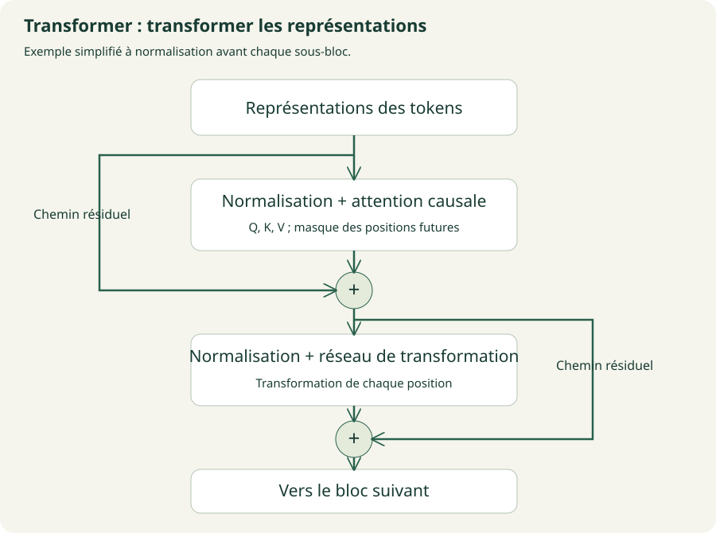

# Comprendre le Transformer et son attention

## Ce que tu sauras faire

Décrire un bloc Transformer, expliquer le masque causal et relier l'attention au coût du contexte. Prérequis : [[Comprendre un LLM]] et [[Vecteurs matrices et similarité]].

## Une architecture, plusieurs usages

Transformer désigne une famille d'architectures, pas un produit ni un synonyme de chatbot. Le papier initial présente un système encodeur-décodeur pour la traduction. Des architectures à encodeur, à décodeur ou combinant les deux servent ensuite des objectifs différents. De nombreux LLM génératifs utilisent des blocs de décodeur avec attention causale.

Le texte est transformé en tokens puis en vecteurs. Un mécanisme de position donne au modèle de l'information sur leur ordre. Plusieurs blocs transforment ces représentations. Une tête de sortie produit des scores sur le vocabulaire ; un choix de token conduit à la suite du texte. La température règle une transformation de la distribution d'échantillonnage, pas une garantie de véracité.

## Attention : sélectionner et combiner de l'information

Une tête d'attention calcule des projections appelées requêtes Q, clés K et valeurs V. Les produits entre requêtes et clés donnent des scores ; après mise à l'échelle, masque éventuel et softmax, les poids obtenus servent à combiner les valeurs.

Dans le cas standard, la formule est `softmax(QKᵀ / √d_k + masque) V`. La transposée Kᵀ permet de comparer chaque requête aux clés. Le softmax normalise une ligne de scores en poids positifs dont la somme vaut un. L'attention multi-têtes apprend plusieurs projections plutôt qu'une seule.

Un bloc comprend aussi un réseau appliqué aux représentations, des connexions résiduelles et des normalisations. Les variantes modernes modifient ces composants et leur ordre. Le schéma suivant montre les rôles, sans prétendre décrire tous les modèles.

## Pourquoi masquer le futur

Pour prédire la suite, une position ne doit pas consulter le token qu'elle est censée apprendre à prédire. Dans une attention causale standard, la représentation à la position i peut utiliser les positions jusqu'à i, mais pas les suivantes. Pendant l'entraînement, plusieurs positions peuvent être traitées en parallèle grâce à ce masque. Lors d'une génération autoregressive ordinaire, les nouveaux tokens dépendent des choix précédents.

Dans « Le chat dort », si ces trois mots étaient trois tokens pour notre exemple, l'état sur « chat » pourrait utiliser « Le » et « chat » afin de prédire la suite. Il ne lirait pas directement « dort ». La vraie tokenisation peut être différente.

## Conséquence pour une intégration

L'attention complète sur n positions implique un nombre de paires proportionnel à n². Les algorithmes d'implémentation peuvent réduire les mouvements mémoire ou éviter de matérialiser toute la matrice ; les architectures à attention locale changent aussi le problème. Il ne faut donc pas convertir n² en une prédiction universelle de latence.

Le cache KV évite de recalculer certaines représentations du passé en génération ; il consomme de la mémoire. Un grand contexte annoncé n'est pas une preuve que le modèle retrouve toutes les informations importantes. Voir [[Estimer la mémoire et comprendre la quantification]].

## Exercice : ce qu'une position peut voir

Une séquence comporte quatre tokens A, B, C, D. Pour prédire D à partir de l'état sur C, lister les tokens visibles. Expliquer ensuite pourquoi une visualisation de poids d'attention ne suffit pas à prouver qu'une réponse est correcte.

> [!answer]- Repères de correction
> A, B et C sont visibles dans ce cas causal ; D est masqué. Les poids d'attention décrivent une opération interne, pas un contrôle des faits. Il faut examiner la réponse, ses sources éventuelles et les critères de tâche. Les autres couches contribuent elles aussi au résultat.

## Sources et portée

Sources consultées le 12 novembre 2026. Schéma et séquence sont pédagogiques ; les architectures réelles varient.

- [Vaswani et al. — Attention Is All You Need](https://arxiv.org/abs/1706.03762)
- [Hugging Face — Fonctionnement des Transformers](https://huggingface.co/learn/llm-course/en/chapter1/4)
