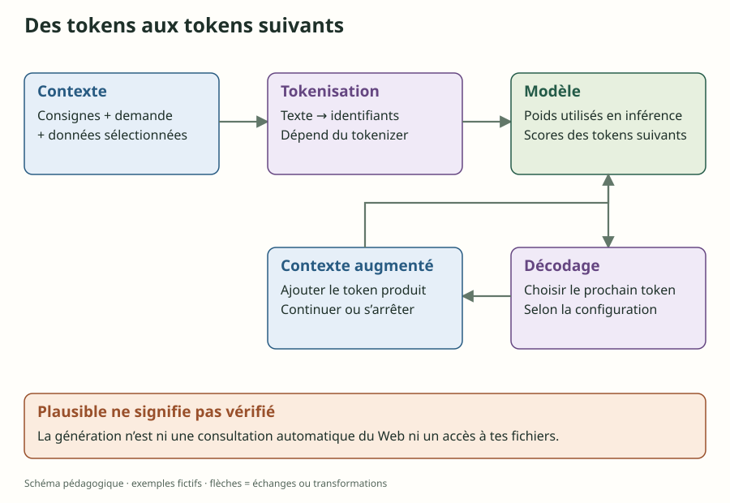

# Comprendre un LLM

## Ce que tu sauras faire

Distinguer poids, contexte et inférence ; expliquer la génération d'un texte ; reconnaître ce qui exige un outil ou une vérification. Cette fiche prolonge [[Du modèle au système]].

> [!abstract] À retenir
> Le contexte guide la génération en cours ; l'entraînement modifie les poids. Un texte plausible n'est pas une preuve. Les accès aux documents et aux outils appartiennent à l'application qui entoure le modèle.

## Suivre la fabrication d'une réponse

Un grand modèle de langage apprend des régularités dans des données. Pour un modèle génératif autorégressif, l'inférence produit une séquence en choisissant des tokens successifs à partir du contexte disponible. Un token peut correspondre à un morceau de mot, un signe ou une autre unité du tokenizer.

Le modèle calcule des scores sur les tokens possibles. Le décodage transforme ces scores en choix selon une configuration : sélection déterministe ou échantillonnage, limites de longueur et conditions d'arrêt. Ce schéma simplifie les implémentations réelles ; il ne représente pas la génération comme une recherche de phrases déjà stockées.

## Poids, contexte et application : trois rôles

| Élément | Ce qui change | Exemple |
| --- | --- | --- |
| Poids | Lors d'un entraînement ou d'une adaptation | Ajuster les paramètres sur des données |
| Contexte | D'un appel à l'autre | Ajouter une consigne et un document |
| Application | Selon le logiciel d'intégration | Lire un fichier ou exécuter un outil autorisé |

Un modèle peut produire une réponse différente après l'ajout d'un exemple sans aucun changement de ses poids. Une application peut aussi mémoriser un historique dans une base, puis le remettre dans le contexte. Cette mémoire applicative ne signifie pas que le modèle a appris durablement chaque conversation.

> [!warning] Une connaissance apparente n'est pas un accès
> Le modèle peut parler d'une base de données sans y être connecté. Il ne peut vérifier son contenu actuel que si l'application lui fournit ce contenu ou un outil autorisé. Une réponse assurée ne démontre pas qu'une vérification a eu lieu.

## Exemple résolu : classer une demande

Demande fictive : « Mon compte est bloqué depuis ce matin ». L'application fournit les catégories facturation, accès, incident et à clarifier, avec une convention qui range les comptes bloqués dans accès.

> [!example] Raisonnement d'intégration
> Le modèle reçoit la règle et le texte. Il propose la catégorie accès. L'application vérifie le format, l'appartenance aux catégories autorisées et, lors de l'évaluation, la correspondance avec la référence humaine. Aucun accès au compte n'est nécessaire pour ce classement ; aucune réinitialisation n'est autorisée.

Une syntaxe JSON valide ne garantit pas la bonne catégorie. De même, une seule demande correctement classée ne démontre pas la fiabilité sur les demandes ambiguës, mal orthographiées ou mêlant plusieurs sujets.

> [!tip] Avant de choisir un modèle plus gros
> Définir le résultat attendu, fournir les informations nécessaires, réserver une issue d'abstention et constituer un jeu de test distinct des exemples. Mesurer ensuite les erreurs qui restent.

## Exercice guidé : qu'est-ce qui a changé ?

Sans modifier le modèle, tu ajoutes deux exemples au prompt et la catégorie proposée change. Les poids ont-ils été mis à jour ? Quel composant doit exécuter une action métier éventuelle ?

> [!answer]- Correction
> Seul le contexte de l'inférence a changé ; aucun entraînement n'est décrit. Une action métier passe par l'application et ses outils, avec validation et permissions. Le texte du modèle ne suffit pas à exécuter ou à autoriser cette action.

## Exercice autonome : comparer deux consignes

Pour classer des demandes, écris une instruction contenant la tâche, les catégories autorisées et deux exemples. Fais varier les formulations sur les mêmes demandes de test. Note les changements, sans considérer une seule bonne réponse comme une preuve de fiabilité.

Voir [[Évaluer une intégration]] et [[Du modèle au système]].

> [!answer]- Repères de correction
> **Consigne possible** : « Classe la demande dans facturation, accès, incident ou à clarifier. Retourne uniquement un objet avec la clé categorie. Si plusieurs sujets sont présents ou si les informations manquent, utilise à clarifier. »
>
> **Deux exemples de démonstration** : « Je souhaite une copie de ma facture » → facturation ; « Mon mot de passe est oublié » → accès. Ces exemples ne font pas partie du test final.
>
> **Test distinct** : « Le service affiche une erreur 500 » → incident ; « J'ai besoin d'aide » → à clarifier ; « Ma facture est fausse et mon compte est bloqué » → à clarifier selon la convention retenue.
>
> Compare deux formulations en conservant modèle, paramètres et demandes identiques. Note pour chaque réponse sa validité JSON, la catégorie et la durée. Une variation de prompt peut changer la sortie sans changer les poids : c'est de l'inférence, pas de l'entraînement.
>
> **Limite** : les catégories ci-dessus sont des références pédagogiques ; aucun résultat d'un modèle n'est prétendu mesuré ici. Un succès sur trois demandes ne valide pas une mise en production.

## Source

[Text generation — Hugging Face Transformers](https://huggingface.co/docs/transformers/llm_tutorial), consulté le 12 novembre 2026. Introduction conceptuelle ; aucune API de version particulière n'est requise pour cet exercice.
