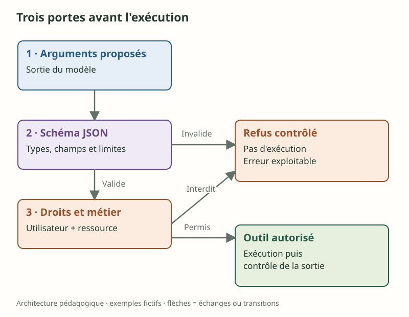

# Concevoir un contrat d'outil et un schéma JSON

Prérequis : [[Appeler des outils avec un modèle]] ; [[Authentification : clés, OAuth et comptes de service]].

## Ce que tu sauras faire

- Définir une entrée d'outil précise et limitée.
- Lire les règles essentielles d'un schéma JSON.
- Séparer validation de structure, contrôles métier et permissions.

> [!abstract] À retenir
> Un schéma décrit les formes acceptées. Le logiciel doit encore vérifier que l'action est autorisée, cohérente et réalisable sur la ressource demandée.

## Du texte libre à un contrat

Un outil doit avoir un **nom non ambigu**, une description de sa fonction, des arguments définis et une sortie exploitable. Il faut préciser ses effets : lecture seule, écriture, envoi ou suppression. Un nom comme « gérer les tickets » est trop vague pour savoir quelles conséquences un appel entraîne.

| Partie du contrat | Exemple pédagogique |
| --- | --- |
| Nom | lire_ticket |
| Effet | Lecture seule |
| Entrée | Un identifiant borné |
| Sortie réussie | Identifiant, statut, résumé autorisé |
| Échec attendu | Ticket inaccessible, inexistant ou service indisponible |
| Contrôle externe | Droit de lecture sur ce ticket |

Le modèle propose les arguments. Le runtime décide s'il appelle l'outil. Ce partage prolonge [[Appeler des outils avec un modèle]].



## Lire un schéma minimal

Le schéma suivant est un exemple général de JSON Schema, pas une garantie de compatibilité avec tous les fournisseurs de modèles.

```json
{
  "type": "object",
  "properties": {
    "ticket_id": {
      "type": "string",
      "minLength": 1,
      "maxLength": 64
    }
  },
  "required": ["ticket_id"],
  "additionalProperties": false
}
```

| Mot-clé | Ce qu'il impose |
| --- | --- |
| type | La catégorie de valeur attendue |
| properties | Les règles des propriétés déclarées |
| required | Les propriétés dont la présence est obligatoire |
| additionalProperties: false | Le refus des propriétés supplémentaires |

Déclarer un champ dans `properties` ne le rend pas obligatoire. Et une chaîne non vide peut rester un identifiant inconnu. Les contraintes du schéma complètent les vérifications métier ; elles ne les remplacent pas.

> [!warning] Ne pas confier l'autorisation aux arguments
> Ajouter un champ « role: admin » que le modèle remplit ne prouve aucun droit. L'identité et les permissions viennent du contexte authentifié du logiciel.

## Exemple résolu : deux refus différents

Une proposition contient `ticket_id: 42`. Elle ne respecte pas le type chaîne : le logiciel la rejette avant l'exécution. Une autre contient `ticket_id: "BETA-42"` : la structure peut être valide, mais un utilisateur Alpha ne possède pas nécessairement le droit de lire Beta.

> [!example] Retour exploitable
> Pour une entrée invalide, indiquer un code stable et le champ à corriger sans recopier des secrets. Pour un refus d'accès, éviter de confirmer des détails sur une ressource protégée si la politique exige de masquer son existence.

## Tester le contrat

> [!tip] Matrice de vérification
> Tester un appel valide, un champ absent, un mauvais type, une chaîne trop longue, une propriété inattendue, un identifiant inaccessible et une panne du service. Vérifier qu'aucun échec préalable ne déclenche l'action.

Contrôler également la sortie de l'outil : taille, champs autorisés et contenu renvoyé au modèle. Une réponse d'outil contient des données potentiellement non fiables ; elle ne doit pas acquérir le statut d'instruction système. Les exigences spécifiques à MCP sont présentées dans [[Situer MCP]].

## Exercice : trois propositions

Avec le schéma ci-dessus, examine les objets suivants, pour un utilisateur autorisé seulement sur Alpha.

```json
{"ticket_id": 42}
{"ticket_id": "ALPHA-7", "role": "admin"}
{"ticket_id": "BETA-42"}
```

Pour chaque ligne, indique le contrôle qui doit arrêter l'appel. Peut-on tout résoudre en écrivant « respecte les permissions » dans le prompt ?

> [!answer]- Repères de correction
> **Premier objet** : le type est incorrect. Le schéma exige une chaîne ; aucune lecture n'est exécutée.
>
> **Deuxième objet** : role est une propriété supplémentaire interdite. Même si ce champ était accepté ailleurs, il ne pourrait pas accorder un rôle à son émetteur.
>
> **Troisième objet** : la structure est valide, mais le contrôle d'accès refuse Beta. L'outil ne retourne aucun contenu de ce ticket.
>
> **Conclusion** : la consigne peut guider le modèle, mais les contrôles logiciels doivent rester efficaces si le modèle l'ignore. Réussite de l'exercice : identifier les deux niveaux de validation et l'absence d'exécution pour les trois cas.

## Sources et portée

Sources consultées le 12 novembre 2026. Exemple original ; vérifier le sous-ensemble de JSON Schema accepté par le moteur choisi.

- [JSON Schema — Objets, propriétés et champs requis](https://json-schema.org/understanding-json-schema/reference/object)
- [MCP — Outils, spécification datée du 18 juin 2025](https://modelcontextprotocol.io/specification/2025-06-18/server/tools)
