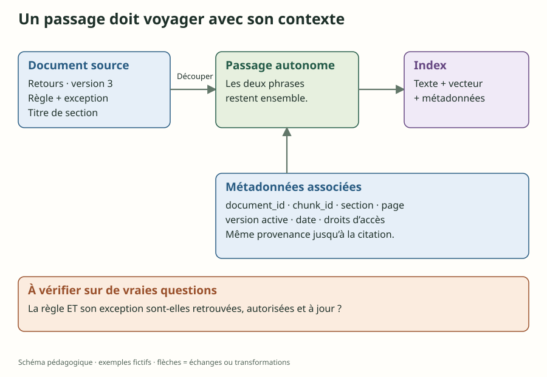

# Découpage de documents et métadonnées

## Ce que tu sauras faire

Choisir une unité de recherche, préserver une règle avec son exception et rattacher chaque passage à sa source. Prérequis : [[Embeddings et RAG documentaire]] et [[Gestion du contexte et budgets de tokens]].

> [!abstract] À retenir
> Un bon passage est assez petit pour être retrouvé précisément, mais assez complet pour être interprété correctement. Son texte, sa provenance et ses droits doivent rester liés.

## Découper selon le sens

Le **chunking** transforme un document en passages indexables. Un découpage par taille fixe est simple ; un découpage par titres ou paragraphes respecte mieux la structure, sans garantir que chaque passage soit autonome. Un tableau séparé de ses en-têtes devient parfois inutilisable. Une procédure privée de son exception peut devenir trompeuse.



| Stratégie | Intérêt | Vérification indispensable |
| --- | --- | --- |
| Taille fixe | Mise en place simple | Les phrases et tableaux restent-ils compréhensibles ? |
| Structure du document | Suit sections et sous-sections | Une section est-elle trop longue ou dépendante d'une autre ? |
| Fenêtres avec chevauchement | Préserve du contexte aux frontières | Le résultat contient-il trop de répétitions ? |
| Petit passage avec contexte parent | Recherche fine, restitution plus large | Le parent respecte-t-il les mêmes droits et le budget ? |

La taille se mesure avec le tokenizer du modèle concerné. Un nombre de caractères ne correspond pas universellement à un nombre de tokens. Le chevauchement peut limiter certaines coupures, mais augmente le volume indexé et les passages redondants. On choisit ses paramètres sur un jeu de questions représentatif, pas sur une valeur réputée magique.

## Exemple résolu : une règle et son exception

Document fictif « Retours, version 3 », section « Produits personnalisés » : « Les retours sont acceptés sous 30 jours. Les produits personnalisés ne sont pas repris, sauf défaut confirmé. »

La question « Peut-on retourner une pièce personnalisée sans défaut ? » exige l'exception. Si la recherche ne retrouve que la première phrase, le générateur peut donner une réponse incorrecte tout en citant une vraie phrase.

> [!example] Décision expliquée
> Conserver les deux phrases dans le passage, avec le titre de section. La réponse attendue est « non, selon cette règle fictive ». La citation doit permettre de retrouver cette section de la version 3.

## Les métadonnées font partie du contrat

Un identifiant de passage stable facilite la traçabilité. La version permet d'écarter une règle périmée. Les droits servent à filtrer les résultats selon l'identité vérifiée, avant d'envoyer les passages au modèle.

```json
{
  "chunk_id": "retours-v3-personnalises-01",
  "document_id": "retours",
  "version": "3",
  "section": "Produits personnalisés",
  "source_page": 2,
  "access_group": "support-interne"
}
```

**Lecture du code** : ce JSON décrit la provenance d'un passage, pas son autorisation effective. Le serveur doit vérifier le groupe de l'utilisateur. Une chaîne de caractères fournie par le client ne prouve aucune appartenance.

> [!warning] Une copie peut survivre à l'original
> Supprimer un document source sans supprimer ses passages, embeddings et caches peut laisser de l'information accessible. Prévoir l'actualisation et la suppression dès l'ingestion.

> [!tip] Méthode de comparaison
> Préparer des questions avec leurs passages de référence. Comparer deux découpages sur la récupération de ces passages, les doublons, la taille du contexte et la qualité des réponses. Garder les autres composants constants.

## Exercice guidé : réparer une coupure

Le passage A contient « Livraison sous 48 heures ». Le passage B contient « Ce délai exclut les commandes personnalisées ». Une question porte sur une commande personnalisée. Quelle réparation privilégier et quelle vérification ajouter ?

> [!answer]- Correction
> Réunir la règle et son exception dans une unité cohérente, ou restituer un parent qui les contient toutes deux. Vérifier que la recherche fournit cette unité pour les questions sur les commandes personnalisées. Augmenter uniquement le nombre de passages ne garantit pas que B soit retrouvé.

## Exercice autonome : changement de procédure

La version 4 remplace 30 jours par 14 jours. Décris une mise à jour permettant de répondre avec la version active, sans perdre la traçabilité des anciennes réponses.

> [!answer]- Correction
> Indexer les nouveaux passages avec leur version ; vérifier le jeu de questions ; basculer le pointeur ou filtre de version active ; invalider les caches concernés. Retirer les anciennes versions du chemin de recherche courant. Un archivage séparé et autorisé peut conserver les références historiques. Vérifier aussi les droits et les suppressions. Le détail de l'atomicité dépend du moteur d'index choisi.
>
> Réussite : distinguer recherche courante et historique, traiter les caches, conserver la provenance et décrire un test après bascule.

## Sources et portée

Sources consultées le 12 novembre 2026. Documents et valeurs d'exercices fictifs ; aucun benchmark n'est revendiqué.

- [Microsoft — Découpage des documents pour RAG](https://learn.microsoft.com/en-us/azure/search/vector-search-how-to-chunk-documents)
- [Hugging Face — Tokenizers](https://huggingface.co/docs/transformers/en/main_classes/tokenizer)

