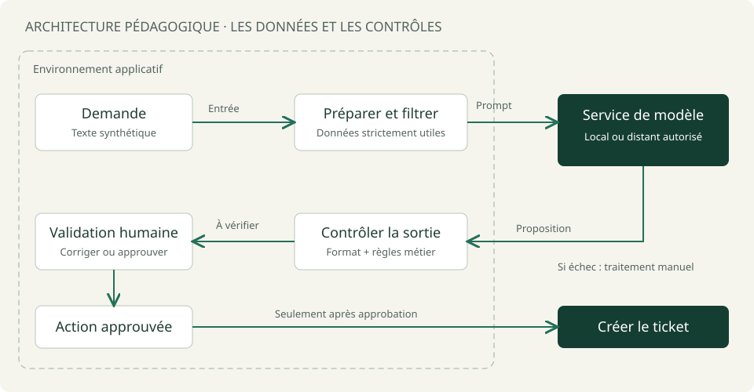

# Du modèle au système

Un système d'IA utile répond à un besoin mesurable. Le modèle en est un composant : il faut aussi préparer ses entrées, interpréter ses sorties et organiser les actions autorisées.

## Un exemple concret

Une équipe reçoit des demandes de support. L'application transmet un message à un modèle pour proposer une catégorie. Le logiciel vérifie ensuite que la catégorie appartient à la liste prévue. Un opérateur valide la proposition avant la création d'un ticket.

Le schéma représente une architecture pédagogique, pas une installation existante. La flèche vers le modèle transporte le texte utile et les instructions ; le retour contient une proposition. Le modèle n'obtient pas automatiquement un accès au logiciel de tickets.

## Questions à poser avant de coder

- Quelle entrée reçoit-on et quel résultat attend-on ?
- Qui peut consulter les données, et où passent-elles ?
- Comment détecter une réponse invalide ou une panne ?
- Une erreur est-elle réversible ? Qui valide une action ?
- Quelle mesure dira que le système améliore le travail ?

## Passer à l'action

Dessine ce circuit avec quatre annotations : donnée échangée, responsable, contrôle et comportement en cas d'échec. Vérifie que chaque action sur un système externe a un responsable explicite.

La suite : [[Comprendre un LLM]], [[Workflow ou agent]] et [[Évaluer une intégration]].

## Sources et portée

Architecture et exercice originaux à but pédagogique. Pour distinguer orchestration prédéfinie et autonomie, voir [Building effective agents — Anthropic](https://www.anthropic.com/engineering/building-effective-agents), consulté le 12 novembre 2026. Les exemples de bibliothèques de cet article de 2024 peuvent avoir évolué.
