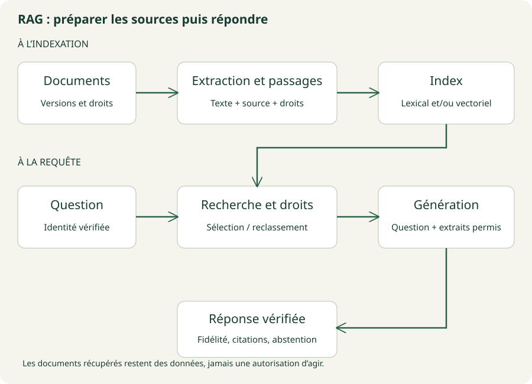

# Embeddings et RAG documentaire

## Ce que tu sauras faire

Expliquer comment une application répond à partir de documents et distinguer une erreur de recherche d'une erreur de génération. Prérequis : [[Comprendre un LLM]] et [[Comprendre une API de modèle]].

## Pourquoi chercher avant de générer

Le RAG, génération augmentée par recherche, consiste à retrouver des informations utiles et à les fournir au modèle dans son contexte. Il permet d'utiliser un corpus qui évolue sans réentraîner systématiquement les poids. Il ne garantit ni la bonne sélection des passages ni une réponse fidèle.

Un embedding représente un contenu par un vecteur de nombres. Un modèle d'embedding organise des contenus dans un espace où une mesure de proximité peut aider à les retrouver. Ce vecteur n'est pas un résumé lisible et un score de similarité n'est pas une probabilité de vérité.

La recherche par mots-clés reste utile pour les références exactes, les codes et les termes rares. Une recherche hybride combine signaux lexicaux et vectoriels. Un reranker peut ensuite réordonner un petit ensemble de candidats en examinant plus précisément leur rapport à la question. Chaque étape a un coût et doit apporter un gain mesuré.

## Deux circuits distincts

À l'indexation, l'application extrait le texte, le découpe et conserve les métadonnées : identifiant du document, version, emplacement du passage, droits et date. Les embeddings des documents et des questions doivent être compatibles ; changer de modèle d'embedding peut imposer de recalculer l'index.

À la requête, le système cherche uniquement dans le périmètre accessible, sélectionne des extraits et les transmet au modèle avec la question. Il conserve le lien entre chaque extrait et sa source. Une citation doit être vérifiée : un lien présent ne prouve pas que le passage soutient la phrase générée.

## Le découpage est une décision métier

Un passage trop court peut perdre une condition importante. Un passage trop long consomme du contexte et mélange les sujets. Pour une procédure, conserver le titre et les étapes liées est souvent une hypothèse raisonnable à tester. Pour un tableau, aplatir les cellules sans en-têtes peut détruire le sens.

Exemple fictif : « le remboursement est possible sous 30 jours, sauf produits personnalisés ». Si seule la première partie est récupérée, la réponse peut devenir trompeuse alors que le modèle suit fidèlement l'extrait reçu. Le problème commence ici avant la génération.

## Évaluer séparément recherche et réponse

Préparer des questions dont on connaît les passages attendus. Vérifier leur présence parmi les résultats, puis la fidélité de la réponse. Ajouter des questions sans réponse dans le corpus : une abstention justifiée peut être le comportement correct. Tester aussi deux utilisateurs aux droits différents.

## Exercice : trois documents synthétiques

Écrire trois petites procédures fictives, dont deux versions d'une même règle. Préparer six questions : deux explicites, deux reformulées, une ambiguë et une sans réponse. Retrouver d'abord les passages manuellement ; ce sera ta référence avant d'automatiser.

> [!answer]- Repères de correction
> **Un corpus possible** : document A, version 1 archivée : « Le délai de remboursement est de 30 jours » ; document B, version 2 en vigueur : « Le délai de remboursement est de 15 jours après validation » ; document C, procédure accès : « Une demande de réinitialisation passe par le portail interne ». Les trois sont fictifs.
>
> **Deux questions explicites** : « Quel délai pour le remboursement ? » → 15 jours après validation, source B ; « Où demander une réinitialisation ? » → portail interne, source C.
>
> **Deux reformulations** : « Quand recevrai-je mon remboursement validé ? » → même passage B ; « J'ai perdu mon accès : par où commencer ? » → passage C si le contexte confirme qu'une réinitialisation est nécessaire, sinon demander une précision.
>
> **Question ambiguë** : « Quel est le délai ? » → demander de quel processus il s'agit. **Question sans réponse** : « Quel est le plafond de remboursement ? » → signaler que le corpus ne le précise pas.
>
> **Vérification** : citer B et sa version en vigueur, pas A. Si B n'est pas retrouvé, corriger la recherche avant d'allonger le prompt. Pour tes propres documents, produire la même grille question, passage, version et comportement attendu. Voir [[Évaluer une intégration]].

## Sources et portée

Sources consultées le 12 novembre 2026. Le circuit est une architecture pédagogique indépendante d'un cloud. Les ACL, c'est-à-dire les listes de droits d'accès, doivent être propagées et vérifiées dans toute implémentation réelle.

- [Microsoft — RAG et recherche](https://learn.microsoft.com/en-us/azure/search/retrieval-augmented-generation-overview)
- [Microsoft — Recherche vectorielle](https://learn.microsoft.com/en-us/azure/search/vector-search-overview)

Suite : [[Quand utiliser un graphe de données]].
