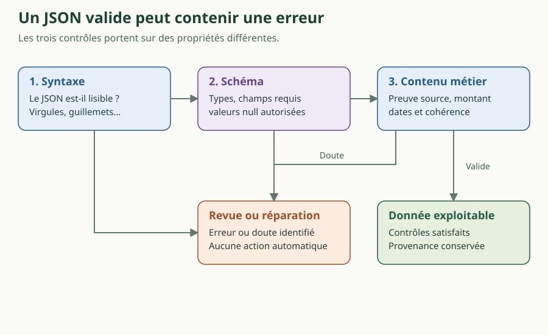

# Évaluer extraction et sorties structurées

## Ce que tu sauras faire

Distinguer validité JSON, conformité au schéma et exactitude métier. Mesurer les erreurs par champ et traiter les valeurs absentes. Prérequis : [[Concevoir un contrat d'outil et un schéma JSON]] et [[Jeux de référence et critères d'acceptation]].

> [!abstract] À retenir
> Un objet JSON parfaitement valide peut contenir un mauvais montant, une date inventée ou un client erroné. Vérifier la forme, la preuve et les règles métier avant toute action.

## Trois contrôles complémentaires



| Contrôle | Ce qu'il détecte | Ce qu'il ne garantit pas |
| --- | --- | --- |
| Analyse JSON | Syntaxe illisible | Types, sens ou fidélité |
| JSON Schema | Champs, types, contraintes déclarées | Véracité des valeurs |
| Validation métier et preuve | Cohérence avec document et règles | Absence de toute erreur future |

Dans JSON Schema, déclarer une propriété ne la rend pas obligatoire : utiliser `required`. `additionalProperties: false` interdit les clés supplémentaires dans l'objet concerné. Une valeur `null` diffère d'une clé absente ; le type doit explicitement permettre `null` si ce cas est attendu. Choisir ces conventions avant de mesurer les performances.

## Exemple résolu : montant et information absente

Document fictif : « Commande C-042. Total : 129,90 EUR. » Le schéma métier demande l'identifiant, le montant en centimes, la devise et la date de livraison ; une date inconnue doit être représentée par `null`.

```json
{
  "commande_id": "C-042",
  "total_centimes": 12990,
  "devise": "EUR",
  "livraison": null
}
```

> [!example] Pourquoi cette représentation ?
> Le montant en centimes est un entier selon notre convention pour l'euro. La date n'est pas déduite de la date du jour. Le document ne la donne pas : `null` exprime cette absence. Conserver séparément l'extrait source qui justifie chaque valeur pour faciliter la revue.

Une conversion financière doit tenir compte de la devise et de sa subdivision ; toutes n'ont pas deux décimales. Pour cet exemple en euros, 129,90 × 100 donne 12 990 centimes. Éviter d'utiliser sans contrôle les flottants binaires pour arrondir des montants. Une date « 03/04/2026 » sans convention régionale explicite peut rester ambiguë : ne pas transformer une hypothèse en référence certaine.

## Mesurer au bon niveau

L'exactitude d'extraction par champ est le nombre de valeurs correctes divisé par le nombre de champs évalués selon la convention fixée. La réussite par document exige que tous ses champs obligatoires et règles métier soient corrects. Nommer clairement la mesure pour ne pas la confondre avec la précision d'un classificateur.

| Mesure sur 10 commandes fictives | Résultat | Lecture |
| --- | --- | --- |
| JSON analysable | 10/10 | Aucune erreur de syntaxe |
| Montant correct | 8/10 | Deux risques sur un champ critique |
| Tous les champs corrects | 7/10 | Trois documents nécessitent réparation ou revue |

> [!warning] Une moyenne peut cacher les erreurs coûteuses
> Si les références faciles sont parfaites mais les montants erronés, une forte moyenne de champs reste insuffisante. Mesurer par champ, type de document et qualité de scan. Fixer une règle pour les absences, les abstentions et les valeurs ambiguës ; ne pas les retirer silencieusement du dénominateur.

> [!tip] Une tâche, plusieurs solutions
> Comparer règles déterministes, extraction documentaire et modèle sur les mêmes exemples. Un petit modèle peut convenir à un format stable ; un document dégradé ou une exception peut demander une autre chaîne de traitement. La taille du modèle ne remplace pas la mesure.

## Exercice guidé : valider n'est pas vérifier

Le schéma accepte un entier positif pour `total_centimes`. Le modèle produit 1299 au lieu de 12990. Quel contrôle échoue et pourquoi le schéma ne suffit-il pas ?

> [!answer]- Correction
> La valeur respecte le type et la borne, mais elle contredit le document. La vérification du contenu et de la conversion doit détecter un montant dix fois trop faible. Ajouter une comparaison avec la preuve et, si disponibles, des règles de cohérence entre lignes, taxes et total. Un schéma plus strict ne connaît pas automatiquement le bon total de chaque commande.

## Exercice autonome : définir le score

Sur 20 documents, 12 comportent une date. Le système extrait correctement 10 de ces dates et invente une date sur 3 des 8 documents sans date. Les autres absences deviennent `null`. Calcule l'exactitude du champ et propose deux mesures complémentaires.

> [!answer]- Correction
> Avec `null` comme référence pour une date absente, 10 dates + 5 absences sont correctes : 15/20 = 75 %. Rapporter aussi 10/12 ≈ 83,3 % sur les dates présentes et 3/8 = 37,5 % d'invention sur les absences. Les deux dates présentes incorrectes restent des échecs ; leur type précis est à inspecter. Le score global seul masquerait le problème d'invention.

## Sources et portée

Source consultée le 12 novembre 2026. Conventions de données et métriques explicitées pour ce cas fictif ; aucune compatibilité particulière d'API n'est supposée.

- [JSON Schema — Objets, propriétés requises et propriétés supplémentaires](https://json-schema.org/understanding-json-schema/reference/object)

