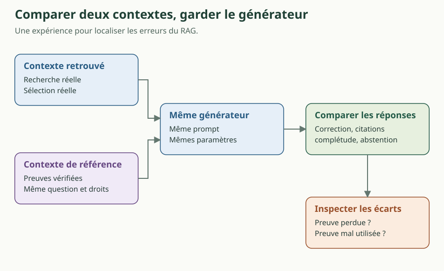

# Évaluer séparément retrieval et génération

## Ce que tu sauras faire

Localiser l'échec d'un RAG : indexation, recherche, sélection ou génération. Calculer un rappel documentaire simple et comparer deux contextes. Prérequis : [[Jeux de référence et critères d'acceptation]] et [[Construire une réponse sourcée et une abstention]].

> [!abstract] À retenir
> Une mauvaise réponse n'implique pas nécessairement un mauvais générateur. Vérifier d'abord si les preuves nécessaires étaient dans son contexte. Tester chaque étage puis le système complet.

## Poser quatre questions de diagnostic

| Étage | Question | Trace minimale |
| --- | --- | --- |
| Corpus | La bonne version est-elle indexée et autorisée ? | Version, identifiant, droits |
| Recherche | Les passages pertinents sont-ils retrouvés ? | Identifiants et rangs des candidats |
| Contexte | Les preuves survivent-elles à la sélection ? | Passages effectivement envoyés |
| Génération | La réponse utilise-t-elle correctement les preuves ? | Affirmations, citations, abstention |

**Éviter de journaliser des données sensibles sans contrôle.** Pour diagnostiquer, des identifiants et résultats de vérification peuvent suffire ; l'accès aux extraits complets doit rester limité. Le périmètre de la référence doit correspondre aux droits du rôle testé.

## Calculer le rappel à k

Pour une question dont l'ensemble de passages pertinents est connu, le rappel à k est la part de ces passages présents parmi les k premiers résultats. On compte des identifiants uniques : deux copies de la même preuve ne valent pas deux preuves.

> [!formula] Rappel documentaire pour une question
> Rappel@k = nombre de passages pertinents retrouvés dans les k premiers / nombre total de passages pertinents de référence

> [!example] Calcul résolu
> Référence : P2, P5, P8. Résultats à k = 4 : P5, P9, P2, P1. Deux preuves sur trois sont retrouvées : rappel@4 = 2/3 ≈ 66,7 %. La précision@4 est 2/4 = 50 %. Ce résultat ne prouve pas que les deux preuves suffisent pour répondre : P8 peut porter une exception indispensable.

L'annotation documentaire est parfois incomplète ou plusieurs passages constituent des preuves alternatives. Définir l'unité de pertinence et relire les résultats non annotés avant de les considérer comme faux. Quand il n'existe aucune preuve attendue, le dénominateur est nul : évaluer ces questions dans la catégorie « sans réponse », sans leur attribuer arbitrairement un rappel nul ou parfait.

## Comparer avec un contexte de référence

Fournir au même générateur un contexte préparé et vérifié par un humain. Garder question, prompt et paramètres constants. Si la réponse reste mauvaise avec ce contexte, enquêter sur les instructions, l'ambiguïté, le raisonnement ou le modèle. Si elle devient correcte, la recherche et la composition du contexte sont des pistes prioritaires. Cette expérience oriente l'enquête ; elle n'isole pas parfaitement chaque interaction.

> [!warning] Fidélité et vérité diffèrent
> Une réponse fidèle à une source fausse ou périmée peut rester fausse. Évaluer séparément correction métier, soutien des citations, complétude, abstention et respect des droits. Un juge LLM éventuel doit être comparé à des annotations humaines.

> [!tip] Tableau de bord minimal
> Présenter rappel documentaire, réponses acceptables, réponses non soutenues, abstentions utiles et inutiles, puis latence et coût. Garder les comptes bruts et les catégories. Une seule moyenne masque le lieu de la panne.

## Exercice guidé : le rappel ne suffit pas

Trois passages de référence A, B, C sont nécessaires. Le contexte contient A, B et deux copies de B. Quel est le rappel ? La présence de quatre passages rend-elle la réponse complète ?

> [!answer]- Correction
> Deux identifiants pertinents uniques sur trois : 2/3, soit environ 66,7 %. Les doublons n'augmentent pas le rappel. C reste absent et peut changer la conclusion. Retrouver C et supprimer les répétitions avant de conclure à une limite du générateur.

## Exercice autonome : isoler la panne

Sur 20 questions répondables, 10 réponses sont acceptables avec le contexte retrouvé et 17 avec le contexte de référence. Que peut-on conclure ? Que faire des trois échecs restants ?

> [!answer]- Correction
> Les résultats suggèrent une marge importante dans la récupération ou la composition du contexte. Inspecter les différences cas par cas : preuves absentes, tronquées ou noyées. Pour les trois échecs avec référence, vérifier annotations, question, instructions et utilisation des preuves. Les 7 réussites supplémentaires ne démontrent pas à elles seules qu'un moteur précis est responsable. Répéter si les sorties varient et confirmer sur des cas indépendants.

## Sources et portée

Sources consultées le 12 novembre 2026. Les calculs et le protocole comparatif sont des exemples pédagogiques ; les chiffres ne sont pas des benchmarks.

- [Sentence Transformers — Évaluation des cross-encoders](https://www.sbert.net/docs/package_reference/cross_encoder/evaluation.html)
- [Gao et al. — Correction et qualité des citations](https://arxiv.org/abs/2305.14627)

