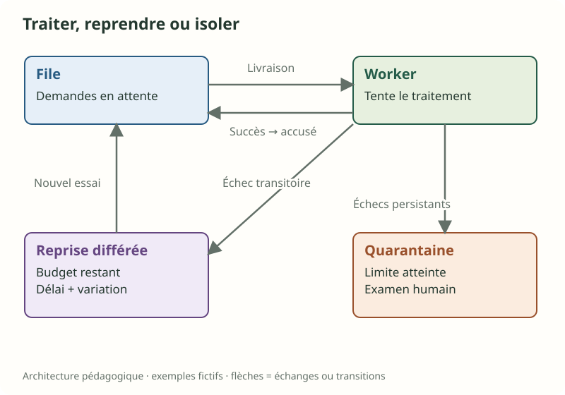
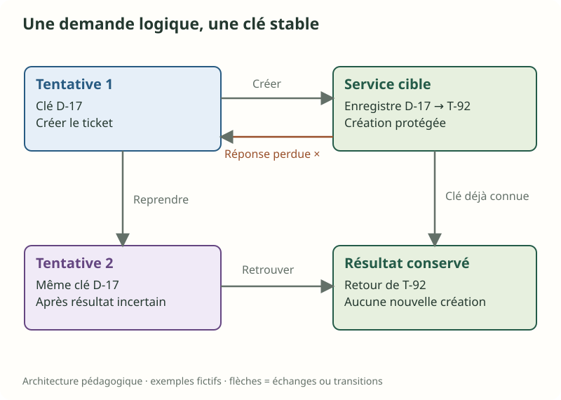

# Files de messages, reprises et idempotence

Prérequis : [[HTTP, TLS, proxy et reverse proxy]] ; [[Le rôle du harness]].

## Ce que tu sauras faire

- Distinguer réception d'un message et réussite de son traitement.
- Expliquer pourquoi une livraison peut se répéter.
- Concevoir une création de ticket qui résiste à une réponse perdue.

> [!abstract] À retenir
> « Je n'ai pas reçu la réponse » ne signifie pas « l'action n'a pas eu lieu ». Une reprise doit tenir compte de cet état incertain.

## Découpler réception et traitement

Une **file de messages** permet à un producteur de déposer des tâches qu'un consommateur traite ensuite. Elle peut absorber un décalage temporaire entre arrivées et capacité de traitement. Elle ne crée ni capacité de calcul supplémentaire ni garantie automatique de délai.

| Étape | Question à résoudre |
| --- | --- |
| Publication | Le système de messagerie a-t-il accepté le message ? |
| Livraison | Quel consommateur reçoit la tâche ? |
| Traitement | L'effet métier a-t-il réellement réussi ? |
| Accusé de réception | Peut-on considérer cette livraison comme traitée ? |
| Échec final | Où retrouver la tâche et qui la reprend ? |

Dans des configurations de livraison au moins une fois, un consommateur peut recevoir à nouveau un message si son accusé n'est pas parvenu au broker. Les confirmations côté producteur et les accusés côté consommateur concernent deux étapes distinctes.

> [!warning] Pas de garantie « exactement une fois » par simple ajout d'une file
> Si un worker crée un ticket puis tombe avant l'accusé, une nouvelle livraison peut provoquer une seconde création. La protection doit inclure le système qui réalise l'effet métier.

## Rendre l'effet idempotent

Une opération est idempotente si la répéter avec la même intention ne multiplie pas son effet attendu. Pour une création, une stratégie consiste à transmettre une **clé stable par demande logique**, puis à faire reconnaître cette clé par le service cible.

> [!example] Réponse perdue
> La demande D-17 crée le ticket T-92. La réponse réseau se perd. Lors de la reprise, la même clé D-17 permet au service de retourner T-92 au lieu de créer un nouveau ticket. Une nouvelle clé à chaque tentative détruirait cette protection.

Un contrôle « chercher puis créer » effectué sans garantie atomique peut échouer si deux workers le font en parallèle. Selon l'architecture, utiliser une contrainte unique transactionnelle, un registre d'opérations ou une API cible idempotente. Une transaction locale ne couvre pas automatiquement un service externe : il faut penser à l'ensemble du circuit.

## Organiser les reprises

| Situation | Réaction possible |
| --- | --- |
| Service temporairement indisponible | Réessais limités, délai croissant et variation aléatoire |
| Identifiants invalides | Arrêt et correction de configuration |
| Données métier invalides | Correction des données ou traitement humain |
| Résultat d'écriture incertain | Vérification par clé stable avant nouvelle action |
| Échecs persistants | File d'échec ou quarantaine, diagnostic et reprise contrôlée |

> [!tip] Méthode
> Fixer une limite de tentatives et une échéance globale. Conserver identifiant, nombre d'essais et état. Surveiller la taille de la file et l'âge de la plus vieille demande : un système peut répondre aux requêtes HTTP tout en accumulant du retard.

Une quarantaine n'est pas une résolution automatique. Il faut un responsable, une règle de conservation et une procédure de remise en circulation. Relier ces événements à [[Observer et diagnostiquer une application IA]].

## Exercice : la panne au mauvais moment

Un worker reçoit D-17, crée T-92, puis tombe avant d'enregistrer localement le résultat et avant d'accuser réception. Le broker relivre D-17. La cible ne propose pas d'API idempotente.

- Pourquoi relire le seul registre local ne suffit-il pas ?
- Quelle information aiderait à rapprocher l'action distante ?
- Peut-on promettre l'absence de doublons sans changer le protocole ?

> [!answer]- Repères de correction
> **Registre local** : il peut ne contenir aucune réussite alors que T-92 existe. Cette absence ne prouve pas l'échec distant.
>
> **Rapprochement** : conserver une référence stable D-17 dans la ressource distante, si le service le permet, et rechercher cette référence lors de la reprise. Pour résister à la concurrence, la cible doit idéalement garantir son unicité de façon atomique.
>
> **Limite** : sans idempotence cible, contrainte d'unicité ou protocole de coordination approprié, une recherche suivie d'une création peut encore être concurrente. Ne pas promettre une garantie non démontrée ; isoler les états incertains pour réconciliation plutôt que recréer aveuglément.

## Sources et portée

Sources consultées le 12 novembre 2026. Scénarios originaux ; les garanties dépendent de la file, de sa configuration et de la cible.

- [RabbitMQ — Accusés et confirmations](https://www.rabbitmq.com/docs/confirms)
- [IETF — Méthodes idempotentes, RFC 9110](https://www.rfc-editor.org/rfc/rfc9110.html#section-9.2.2)
- [AWS Builders' Library — API idempotentes et reprises](https://aws.amazon.com/builders-library/making-retries-safe-with-idempotent-APIs/)
