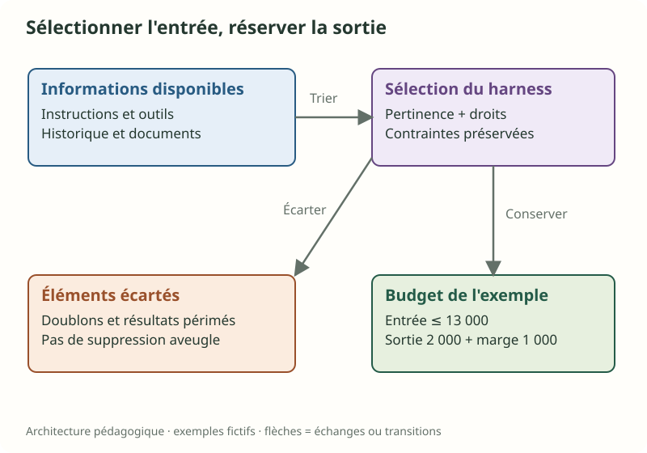

# Gestion du contexte et budgets de tokens

Prérequis : [[Comprendre un LLM]] ; [[Estimer la mémoire et comprendre la quantification]] ; [[Embeddings et RAG documentaire]].

## Ce que tu sauras faire

- Inventorier les éléments qui consomment le contexte.
- Calculer un budget pédagogique d'entrée et de sortie.
- Réduire un historique en préservant les contraintes et la provenance.

> [!abstract] À retenir
> La question n'est pas seulement « combien de tokens puis-je envoyer ? », mais « quelles informations sont nécessaires à cette décision ? ». Une grande fenêtre ne garantit pas une bonne exploitation de tout son contenu.

## Le contexte est assemblé par l'application

Les instructions, la demande, l'historique, les descriptions d'outils et les résultats retrouvés peuvent tous occuper de la place. Le format exact dépend du modèle et du service. Les images et les autres modalités peuvent aussi contribuer à la consommation selon une comptabilisation propre au fournisseur.

| Élément | Ce qu'il faut préserver | Ce qui peut être réduit |
| --- | --- | --- |
| Instructions | Objectif, règles et limites | Répétitions inutiles |
| Historique | Décisions et contraintes actives | Étapes dépassées |
| Documents | Preuves pertinentes et références | Passages hors sujet |
| Outils | Capacités nécessaires à la tâche | Outils indisponibles ou inutiles |
| Résultats d'outils | Faits utiles, statut et erreurs | Dumps volumineux non pertinents |

> [!warning] Ne pas mélanger données et autorité
> Un document retrouvé ou une réponse d'outil peut contenir des instructions hostiles. Les traiter comme des données à analyser, pas comme une nouvelle règle système.

## Calculer avant de tronquer

Dans l'exemple suivant, le service fictif impose une fenêtre combinée de **16 000 tokens**. Nous réservons **2 000 tokens** de sortie et **1 000 tokens** de marge. Ces nombres ne décrivent aucun modèle particulier.

> [!formula] Budget pédagogique
> Entrée cible ≤ 16 000 − 2 000 − 1 000 = 13 000 tokens

| Entrée envisagée | Tokens fictifs |
| --- | --- |
| Instructions et outils | 2 000 |
| Historique utile | 4 000 |
| Passages documentaires | 6 000 |
| Demande actuelle | 500 |
| Total | **12 500** |

Il reste 500 tokens dans l'entrée cible. Ajouter un résultat d'outil de 3 000 tokens obligerait à revoir la sélection. Vérifier aussi les limites de sortie propres au service, les tokens spéciaux, les gabarits de conversation et les éventuels tokens de raisonnement : la formule pédagogique ne remplace pas son contrat réel.

> [!example] Compter avec le bon instrument
> Une limite en caractères n'est pas une limite en tokens. Utiliser le tokenizer et le format de conversation adaptés au modèle lorsque disponibles, puis confronter l'estimation aux mesures fournies par le service.

## Réduire sans effacer les décisions

Un résumé utile conserve l'objectif, les contraintes actives, les décisions prises, les références des preuves et les questions ouvertes. Il doit distinguer ce qui a été observé de ce qui reste supposé. Il ne remplace pas nécessairement la source complète.

> [!tip] Exemple de mémoire de travail
> « Objectif : classer les demandes. Interdit : envoyer des réponses clients. Décision : validation humaine avant création. Preuve : compte rendu synthétique A, version 2. À confirmer : débit de pointe. » Cette structure conserve les éléments qui gouvernent l'action suivante.

Éviter de conserver indéfiniment chaque détail d'une conversation. Mais supprimer mécaniquement les premiers messages peut faire disparaître une contrainte toujours active. Tester la qualité après sélection ou résumé, notamment sur les exceptions rares. Voir [[Le rôle du harness]] et [[Évaluer une intégration]].

## Exercice : une compression dangereuse

Dans le budget de 16 000 tokens ci-dessus, l'entrée réelle atteint 15 000 tokens. La sortie réservée et la marge restent inchangées. Un résumé réduit l'entrée à 12 500 tokens, mais omet « aucune création de ticket sans validation humaine ».

- Quel dépassement fallait-il corriger ?
- Le résumé est-il acceptable parce qu'il rentre ?
- Que faut-il conserver et retester ?

> [!answer]- Repères de correction
> **Budget** : l'entrée cible est de 13 000 tokens. L'entrée de 15 000 dépasse cette cible de 2 000 tokens. Entrée et sortie réservée atteindraient déjà 17 000 tokens, avant même la marge.
>
> **Résumé** : 12 500 respecte le budget cible, mais la contrainte d'autorisation a disparu. La réussite comptable ne constitue pas une réussite fonctionnelle.
>
> **Correction** : conserver explicitement la validation humaine dans les instructions actives, et l'appliquer aussi dans le logiciel. Tester une demande qui pousse à créer immédiatement un ticket ; aucune création ne doit partir sans approbation. Vérifier également que les références utiles et les incertitudes restent identifiables.

## Sources et portée

Sources consultées le 12 novembre 2026. Budgets et scénario originaux, sans appel à un modèle. Les limites et méthodes de comptage sont à vérifier pour chaque service.

- [Anthropic — Context engineering pour agents](https://www.anthropic.com/engineering/effective-context-engineering-for-ai-agents)
- [Hugging Face — Tokenizers](https://huggingface.co/docs/transformers/en/main_classes/tokenizer)
