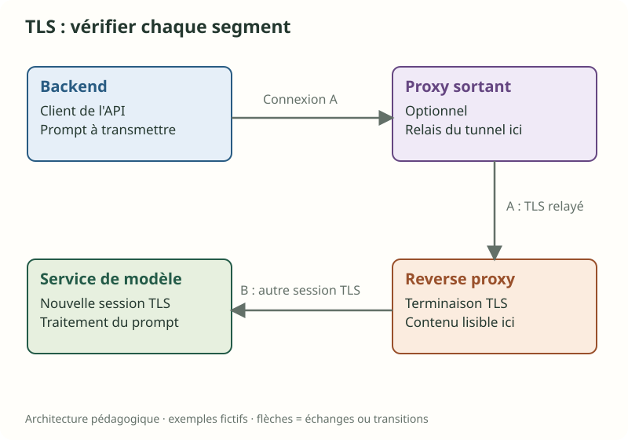

# HTTP, TLS, proxy et reverse proxy

Prérequis : [[Réseaux : IP, ports, DNS et routage]].

## Ce que tu sauras faire

- Lire les composants d'une requête et d'une réponse.
- Placer un proxy et un reverse proxy sur un circuit.
- Expliquer où les données sont chiffrées et où elles peuvent être lues.

> [!abstract] À retenir
> HTTP décrit l'échange applicatif. TLS protège une connexion. Un intermédiaire peut terminer cette connexion et voir son contenu : il faut dessiner chaque segment.

## Une enveloppe et un contenu

Une requête contient notamment une **méthode**, une **cible**, des **en-têtes** et parfois un **corps**. Le corps peut transporter des messages destinés au modèle. La réponse contient un statut, des en-têtes et éventuellement un corps. Cette lecture logique reste utile même lorsque la version du protocole change son encodage sur le réseau.

| Élément | Exemple fictif | Rôle |
| --- | --- | --- |
| Méthode et chemin | POST /classification | Demander un traitement |
| Content-Type | application/json | Décrire le format du corps |
| Authorization | Identifiant transmis selon le contrat | Présenter un justificatif d'accès |
| Statut | 200, 401, 403, 429, 503 | Signaler un résultat HTTP |
| Corps | Objet de classification | Transporter le résultat applicatif |

> [!warning] HTTP 200 ne signifie pas « réponse correcte »
> Le transport peut réussir alors que la catégorie inventée par le modèle est interdite. La validation du résultat reste nécessaire, comme dans [[Comprendre une API de modèle]].

## Où se placent les intermédiaires ?

Un **proxy sortant** agit côté client pour relayer ou contrôler les destinations. Un **reverse proxy** reçoit les appels côté service et les dirige vers les backends. Il peut aussi appliquer des limites, collecter des traces ou terminer TLS. Ces fonctions dépendent de sa configuration.

TLS vise la confidentialité et l'intégrité des échanges et l'authentification du pair selon le mode utilisé. Une connexion HTTPS ordinaire authentifie le serveur auprès du client grâce au certificat vérifié ; elle n'identifie pas à elle seule l'utilisateur métier.

> [!example] Deux connexions à vérifier
> Si le navigateur utilise HTTPS jusqu'au frontal mais que le frontal contacte le modèle en HTTP, le second segment n'est pas chiffré par TLS. Le cadenas du navigateur ne décrit que sa propre connexion. Dans notre schéma, les deux segments sont chiffrés séparément.

Une terminaison TLS autorisée implique un point où les données sont accessibles en clair. Les logs de ce point peuvent donc contenir des informations sensibles. Examiner aussi les journaux dans [[Observer et diagnostiquer une application IA]].

## Distinguer les erreurs avant de réessayer

| Résultat | Lecture utile | Réaction initiale |
| --- | --- | --- |
| 401 | Authentification attendue ou non acceptée | Vérifier les identifiants |
| 403 | Requête comprise mais refusée | Vérifier les droits et la politique |
| 429 | Trop de requêtes selon la limite appliquée | Réduire la cadence, respecter les indications reçues |
| 503 | Service temporairement indisponible | Repli et reprises bornées si appropriées |
| Timeout | Pas de résultat reçu dans le délai | Déterminer si l'action a pu avoir lieu |

> [!tip] Méthode
> Réessayer n'est pas une décision purement réseau. Un appel de génération et une création de ticket n'ont pas les mêmes effets ; prévoir les doublons avant toute reprise.

## Exercice : le cadenas et la réponse invalide

Une application utilise HTTPS vers son frontal. Le frontal parle en HTTP au modèle sur un réseau interne. Le modèle renvoie HTTP 200 avec une catégorie inconnue. Après un timeout sur la création du ticket, le développeur relance immédiatement une nouvelle création.

Identifie trois problèmes distincts et propose une action pour chacun.

> [!answer]- Repères de correction
> **Transport** : le segment frontal → modèle n'est pas protégé par TLS. Vérifier les exigences et configurer le chiffrement de ce segment si requis ; l'adjectif « interne » ne démontre pas sa protection.
>
> **Contrat** : la catégorie inconnue doit être rejetée par la validation applicative. HTTP 200 ne la rend pas acceptable ; la demande rejoint une reprise bornée ou un opérateur.
>
> **Effet métier** : le ticket a pu être créé avant le timeout. Réutiliser un identifiant stable avec un mécanisme d'idempotence et vérifier l'état ; une nouvelle création aveugle peut produire un doublon.

## Sources et portée

Sources consultées le 12 novembre 2026. Scénario original ; les points de terminaison et les garanties dépendent de l'architecture réelle.

- [MDN — Vue d'ensemble de HTTP](https://developer.mozilla.org/en-US/docs/Web/HTTP/Guides/Overview)
- [IETF — Sémantique HTTP, RFC 9110](https://www.rfc-editor.org/rfc/rfc9110.html)
- [MDN — Transport Layer Security](https://developer.mozilla.org/en-US/docs/Web/Security/Transport_Layer_Security)
