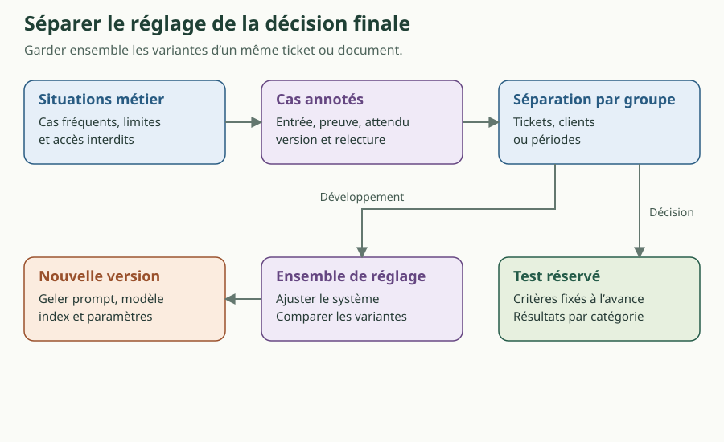

# Jeux de référence et critères d'acceptation

## Ce que tu sauras faire

Transformer un besoin métier en cas vérifiables, garder un test indépendant et décider si une nouvelle version améliore réellement le service. Prérequis : [[Évaluer une intégration]] et [[Matrice de confusion, précision, rappel et F1]].

> [!abstract] À retenir
> Un jeu de référence définit les situations, les preuves et les comportements attendus. Le critère d'acceptation se choisit avant de comparer les versions. Les exemples utilisés pour régler le système ne constituent plus un test indépendant.

## Écrire un cas exploitable

Un **golden set** n'est pas seulement une liste de questions et de phrases idéales. Plusieurs formulations peuvent être correctes. Décrire ce qui doit être vrai, ce qui est interdit, les sources applicables et les conditions d'accès. Pour une action, préciser aussi l'effet attendu et les effets à éviter.

| Champ du cas | Exemple fictif |
| --- | --- |
| Identifiant et famille | RET-017 ; retour personnalisé |
| Entrée et contexte | Produit personnalisé sans défaut, utilisateur support |
| Preuve applicable | Procédure v3, section 2 |
| Attendu | Expliquer l'exclusion et citer l'exception |
| Interdit | Promettre un remboursement ou créer une demande |
| Annotation | Auteur, relecteur, date et version du corpus |

**Séparer vérité de référence et préférence de style.** Une réponse polie mais fausse échoue. Une paraphrase exacte ne doit pas échouer uniquement parce qu'elle diffère de la phrase modèle. Documenter les désaccords entre annotateurs et arbitrer les cas ambigus avant de calculer un score.

## Couvrir le métier, pas seulement les cas faciles

Prévoir des questions fréquentes, rares mais coûteuses, ambiguës, sans réponse, contradictoires et hors autorisation. Un jeu volontairement riche en cas difficiles sert à détecter des risques ; sa moyenne ne représente pas nécessairement le trafic réel. Publier les résultats par catégorie et préciser comment une éventuelle moyenne est pondérée.

> [!example] Une porte de passage explicite
> Pour un pilote fictif de support : au moins 45 réponses acceptables sur 50 cas répondables ; au plus 2 réponses inventées sur 20 cas sans preuve ; aucune divulgation sur 10 tests de droits. Ces seuils illustrent une négociation avec le métier, pas une norme universelle ni une garantie statistique.

## Éviter la fuite entre réglage et test

Un ensemble sert à développer les prompts et paramètres ; un autre est réservé à la décision finale. Si un entraînement est ajouté, isoler également ses données. Les doublons et variantes d'un même ticket doivent rester ensemble. Selon le scénario, séparer par client, document ou période, pour reproduire le type de nouveauté attendu en production.

> [!warning] Regarder le test change son rôle
> Après avoir corrigé le système en fonction de ses erreurs sur le test final, ce test devient une référence de régression connue. Garder ou constituer un nouveau lot indépendant pour estimer la généralisation. Un zéro erreur sur dix cas ne démontre pas un risque nul.

> [!tip] Comparaison reproductible
> Geler corpus, identifiants, annotations, versions de modèle, prompt et paramètres. Évaluer deux versions sur les mêmes cas. Conserver les résultats individuels et répéter les cas sensibles si les sorties varient. Ne pas effacer une erreur parce qu'une seconde tentative réussit.

## Exercice guidé : score global flatteur

Un prototype réussit 95 cas courants sur 100, mais échoue sur 4 des 5 cas d'accès interdit. Le seuil choisi était « aucune divulgation sur les tests de droits ». Peut-on accepter le pilote en invoquant la moyenne ?

> [!answer]- Correction
> Non. Le critère bloquant de confidentialité est violé, même si la moyenne globale paraît élevée. Examiner les quatre échecs, corriger le contrôle d'accès puis retester, y compris sur des variantes indépendantes. Conserver les résultats par catégorie et le nombre de cas.

## Exercice autonome : doublons cachés

Tu disposes de 300 questions issues de 30 tickets, avec dix reformulations par ticket. Tu répartis aléatoirement les questions entre réglage et test. Quel biais apparaît et comment le limiter ?

> [!answer]- Correction
> Des variantes du même ticket apparaissent dans les deux ensembles : le test mesure en partie la reconnaissance de situations déjà utilisées pour régler le système. Répartir les 30 tickets par groupe, puis affecter toutes leurs reformulations au même ensemble. Pour un déploiement sur de nouveaux clients ou de futures périodes, envisager aussi une séparation selon ces dimensions.
>
> Réussite : identifier l'unité de dépendance et annoncer que le volume de situations indépendantes est plus proche de 30 que de 300.

## Sources et portée

Source consultée le 12 novembre 2026. Schéma de cas, seuils et exemples proposés pour l'apprentissage ; ils ne décrivent pas des résultats réels.

- [scikit-learn — Fuites de données et bonnes pratiques](https://scikit-learn.org/stable/common_pitfalls.html#data-leakage)

