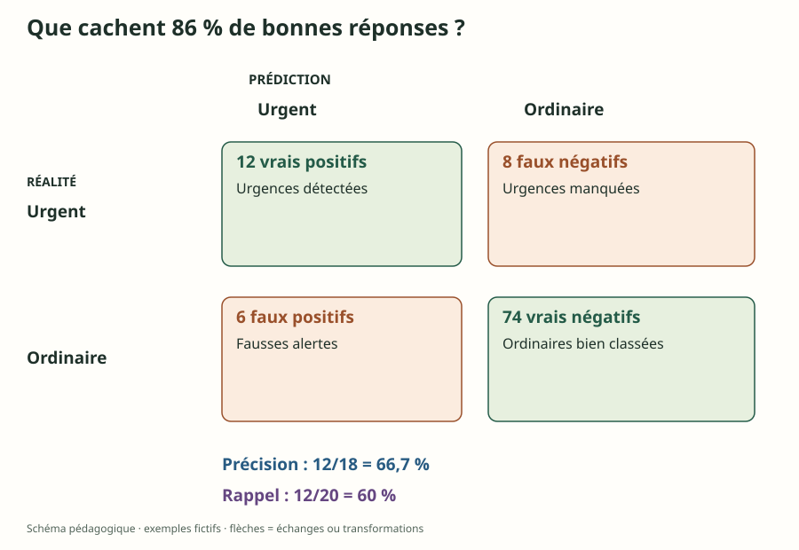

# Matrice de confusion, précision, rappel et F1

## Ce que tu sauras faire

Lire une matrice de confusion, calculer précision et rappel, puis choisir une métrique selon les conséquences métier. Prérequis : [[Évaluer une intégration]].

> [!abstract] À retenir
> Une moyenne globale peut cacher les erreurs importantes. Définis la classe positive, distingue les erreurs, puis examine leur coût avant de choisir une métrique.

## Quatre cases pour nommer les erreurs

On construit un classificateur fictif de demandes **urgentes**. « Positif » signifie ici « urgent », pas « bon ». La référence est établie par des personnes compétentes avec une règle explicite ; elle peut elle-même contenir des désaccords à résoudre.

| Référence / Prédiction | Urgent prédit | Ordinaire prédit |
| --- | --- | --- |
| Urgent réel | 12 vrais positifs (VP) | 8 faux négatifs (FN) |
| Ordinaire réel | 6 faux positifs (FP) | 74 vrais négatifs (VN) |

Les **faux positifs** génèrent des alertes inutiles. Les **faux négatifs** laissent passer des demandes urgentes. Les conséquences ne sont pas interchangeables. Les axes doivent toujours être nommés, car toutes les bibliothèques et tous les graphiques ne les présentent pas de la même façon.

## Trois formules, trois questions

La **précision** répond : parmi les alertes émises, quelle proportion est réellement urgente ?

:::formula precision

Le **rappel** répond : parmi les urgences réelles, quelle proportion a été détectée ?

:::formula recall

Le **F1** combine précision et rappel par leur moyenne harmonique. Il ne tient pas compte des vrais négatifs.

:::formula f1

## Exemple résolu : ne pas se laisser tromper par 86 %

- Précision : 12 / (12 + 6) = **66,7 %**.
- Rappel : 12 / (12 + 8) = **60 %**.
- F1 : 24 / (24 + 6 + 8) = **63,2 %**.
- Exactitude globale : (12 + 74) / 100 = **86 %**.

Dire « 86 % de bonnes réponses » masque que **8 urgences sur 20 sont manquées**. Une règle qui répond toujours « ordinaire » atteindrait déjà 80 % d'exactitude dans cet échantillon. Le gain doit donc être comparé à une référence simple et à l'objectif métier.

> [!warning] Un score sans dénominateur peut être indéfini
> Si aucune alerte n'est émise, la précision a un dénominateur nul. Définis une convention de reporting et indique ce cas ; ne transforme pas silencieusement une absence d'alertes en preuve de qualité.

## Choisir un seuil et un périmètre

Si le système fournit un score ordonné utilisable pour déclencher une alerte, modifier le seuil change les compromis entre faux positifs et faux négatifs. Ce score n'est pas forcément une probabilité calibrée. Choisir le seuil sur un jeu de validation, puis mesurer sur un test distinct.

Pour plusieurs classes, lire les résultats par classe. Une moyenne **macro** donne le même poids aux classes ; une moyenne pondérée par leurs effectifs peut masquer une petite classe difficile. Une décision d'abstention doit être mesurée séparément : part des cas automatisés, erreurs restantes et charge humaine.

> [!tip] Méthode métier
> Décrire le coût d'une urgence manquée et d'une fausse alerte. Vérifier aussi la capacité de l'équipe à traiter les alertes. Comparer les modèles avec les mêmes données et les mêmes conventions, puis inspecter les erreurs.

## Exercice guidé : dix alertes

Parmi 10 alertes, 8 sont justifiées. Le jeu contient 16 urgences réelles. Calcule précision et rappel.

> [!answer]- Correction
> VP = 8, FP = 2 et FN = 8. La précision vaut 8/10 = **80 %**. Le rappel vaut 8/16 = **50 %**. Une bonne proportion d'alertes utiles ne signifie pas que la majorité des urgences est détectée.

## Exercice autonome : choisir entre deux systèmes

A trouve 18 des 20 urgences et déclenche 40 alertes. B trouve 14 des 20 urgences et déclenche 16 alertes. Peux-tu déclarer un vainqueur ?

> [!answer]- Correction
> A : rappel 90 %, précision 45 %. B : rappel 70 %, précision 87,5 %. A manque moins d'urgences mais surcharge davantage l'équipe. Sans coût des erreurs, capacité de traitement et cible d'acceptation, aucun vainqueur universel. Tester une file de revue humaine, mesurer ses délais et conserver un jeu de test distinct. Ces 100 demandes fictives ne suffisent pas à établir une performance en production.

## Sources et portée

Source consultée le 12 novembre 2026. Calculs originaux sur un jeu fictif ; introduction aux métriques, sans estimation d'incertitude statistique.

- [scikit-learn — Métriques de classification](https://scikit-learn.org/stable/modules/model_evaluation.html#classification-metrics)

