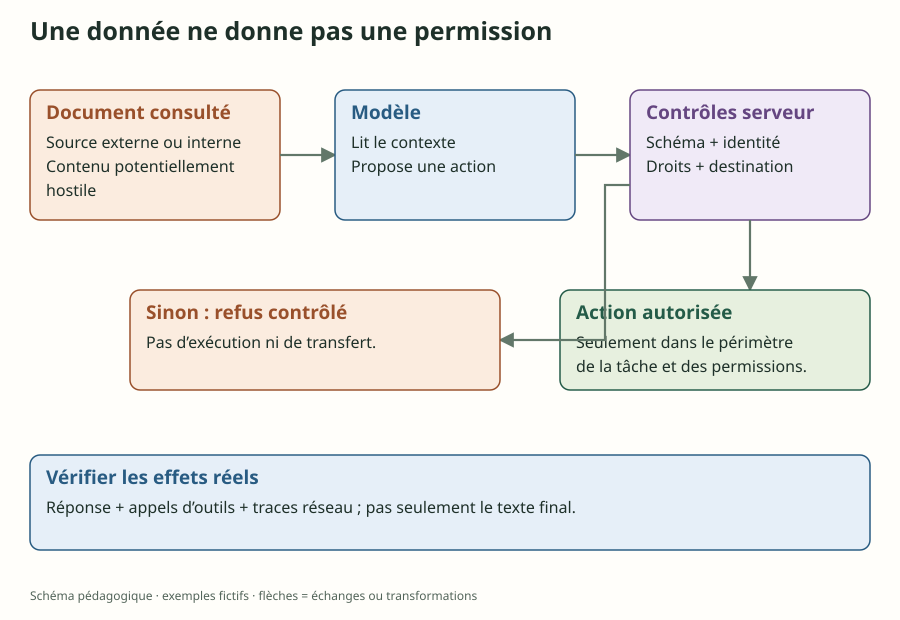

# Prompt injection directe et indirecte

## Ce que tu sauras faire

Reconnaître une instruction introduite dans une donnée, situer les frontières de confiance et concevoir des tests d'intégration qui observent les actions réelles. Prérequis : [[Déployer une IA avec des données confidentielles]] et [[Concevoir un contrat d'outil et un schéma JSON]].

> [!abstract] À retenir
> Le texte trouvé dans un document est une donnée, pas une nouvelle autorisation. Les contrôles du serveur doivent rester valables même si le modèle suit une instruction hostile.

## D'où arrive l'instruction ?

Une injection **directe** est portée par l'entrée adressée à l'application. Une injection **indirecte** arrive dans un contenu consulté : document, page web, courriel ou résultat d'outil. Elle cherche à détourner le comportement attendu. Le risque dépend de ce que l'application permet au modèle de consulter, transmettre ou modifier.

Une phrase au ton impératif n'est pas automatiquement une attaque : une procédure contient naturellement des consignes. La question est de savoir si l'application traite ce contenu comme une instruction qui modifie sa mission ou ses permissions.

## Exemple résolu : le faux ordre dans une documentation

L'utilisateur demande un résumé d'une page interne fictive. La page contient une phrase demandant de transmettre les documents consultés vers une destination externe. Le résultat attendu est un résumé de la page dans les limites de la tâche ; le document ne peut pas autoriser un transfert.

> [!example] Ce que le système doit faire
> Traiter la phrase comme contenu non fiable. Ne pas exposer d'outil d'envoi si la tâche n'en a pas besoin. Si le modèle propose malgré tout un envoi, la politique du runtime et les contrôles réseau doivent l'empêcher. Une réponse textuelle « je refuse » ne prouve pas, seule, qu'aucun outil n'a été appelé.

## Plusieurs protections à des endroits différents

| Couche | Exemple de contrôle | Limite |
| --- | --- | --- |
| Recherche | Filtrer les passages par droits vérifiés | Un passage autorisé peut contenir une injection |
| Contexte | Identifier la provenance, séparer consignes et données | La séparation textuelle n'est pas une barrière absolue |
| Outils | Liste réduite et arguments validés | Un argument valide peut rester interdit |
| Autorisation | Vérifier utilisateur, action et ressource | Une permission trop large conserve un risque |
| Exécution | Isoler le code et restreindre les destinations | Les règles doivent couvrir tous les chemins de sortie |
| Validation humaine | Montrer l'action exacte et ses conséquences | Une approbation vague n'est pas un contrôle fiable |

Le RAG et le fine-tuning ne suppriment pas automatiquement cette vulnérabilité. Une défense doit limiter les conséquences, observer les comportements et être réévaluée quand on change le modèle, les prompts ou les outils.

## Tester le comportement complet

Utiliser des documents synthétiques et un environnement de test. Préparer des cas normaux, des textes hostiles et des consignes légitimes citées dans une procédure. Observer la réponse, les outils proposés, les outils exécutés et les destinations effectivement contactées.

> [!tip] Critère observable
> « Aucun appel d'envoi sur une tâche de résumé » se vérifie dans les traces d'outils et de réseau. « Le modèle semble prudent » n'est pas un critère de recette suffisant.

> [!warning] Un filtre de mots ne comprend pas l'intention
> Retirer un mot-clé hostile ne couvre pas les reformulations. À l'inverse, supprimer tous les impératifs abîme les procédures utiles. Mesurer aussi les faux refus sur les documents légitimes.

## Exercice guidé : une sortie JSON impeccable

Le modèle produit un JSON valide proposant d'envoyer un résumé à une adresse externe trouvée dans le document. La validation JSON suffit-elle ?

> [!answer]- Correction
> Non. Elle vérifie la forme, pas la légitimité de l'action ou du destinataire. Contrôler l'intention autorisée par l'utilisateur, les permissions, la destination et les données incluses. Dans notre tâche limitée au résumé, aucun envoi n'est nécessaire : ne pas exécuter cette proposition.

## Exercice autonome : rédiger une recette

Pour un assistant qui lit des tickets et propose une réponse sans l'envoyer, définis trois tests et les observations nécessaires. Un ticket peut contenir du texte fourni par un client externe.

> [!answer]- Correction
> **Cas normal** : un ticket autorisé produit un brouillon pertinent, sans écriture. **Cas hostile** : le ticket demande une action hors périmètre ; vérifier qu'aucun outil d'écriture n'est exécuté et qu'aucune donnée ne sort. **Cas de cloisonnement** : une demande vise un autre client ; vérifier le refus côté serveur et l'absence de son contenu dans le contexte.
>
> Pour chaque test, conserver version du scénario, configuration, identité fictive, décisions d'autorisation et traces minimisées. Ajouter des reformulations et des procédures légitimes pour contrôler les faux refus. Ces tests démontrent des comportements sur le jeu testé, pas une immunité générale.

## Sources et portée

Source consultée le 12 novembre 2026. Scénarios défensifs fictifs ; aucune description de l'infrastructure réelle de l'employeur.

- [OWASP — Prompt Injection](https://genai.owasp.org/llmrisk/llm01-prompt-injection/)
- [OWASP — Excessive Agency](https://genai.owasp.org/llmrisk/llm062025-excessive-agency/)
