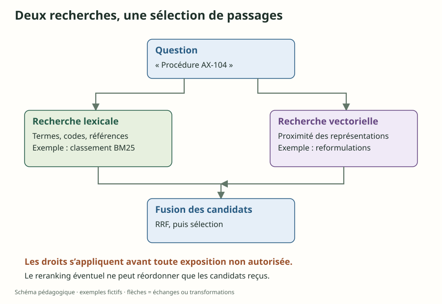

# Recherche lexicale, BM25 et recherche hybride

## Ce que tu sauras faire

Distinguer correspondance lexicale et proximité sémantique, expliquer une fusion par rangs et diagnostiquer un échec de recherche. Prérequis : [[Découpage de documents et métadonnées]] et [[Vecteurs matrices et similarité]].

> [!abstract] À retenir
> Les mots exacts et le sens apportent des signaux complémentaires. Une recherche hybride combine leurs candidats ; sa qualité reste à mesurer sur les vraies questions du métier.

## Deux chemins vers les passages

La recherche lexicale s'appuie sur les termes de la requête et du document. **BM25** est une fonction de classement courante : elle tient notamment compte de la fréquence des termes, de leur rareté dans le corpus et de la longueur des documents. Le traitement des mots dépend aussi de l'analyseur : découpage, casse, accents ou formes fléchies.

La recherche vectorielle compare des représentations numériques. Elle peut rapprocher « impossible de me connecter » et « problème d'authentification » sans exiger les mêmes mots. Cette proximité ne garantit ni la pertinence ni la validité du passage.

| Question fictive | Signal utile | Risque à tester |
| --- | --- | --- |
| Que signifie ERR-417 ? | Code exact | Un code voisin remonte par similarité |
| Pourquoi ma connexion est-elle refusée ? | Sens de la demande | Un texte lexicalement proche parle d'un autre service |
| Procédure X-12 version 4 | Référence et métadonnées | Une ancienne version paraît très pertinente |

## Fusionner sans confondre les scores

Un score BM25 et une similarité cosinus n'ont pas nécessairement la même échelle. Les additionner naïvement peut faire dominer arbitrairement une branche. Une solution est la **fusion réciproque des rangs**, RRF : chaque liste contribue selon la position du document, plutôt que selon son score brut.

> [!formula] Exemple de fusion RRF
> score(d) = somme de 1 / (k + rang(d)) sur les listes contenant d

Dans cet exemple, les rangs commencent à 1. **k** règle l'influence relative des positions ; ce n'est pas le nombre de documents retournés. D'autres fusions existent et un moteur peut pondérer ses branches.

## Exemple résolu : un document soutenu par deux recherches

Avec **k = 60**, A est premier dans la liste lexicale et troisième dans la liste vectorielle. B est deuxième uniquement dans la liste lexicale.

| Document | Contributions | Score approximatif |
| --- | --- | --- |
| A | 1/61 + 1/63 | 0,03227 |
| B | 1/62 | 0,01613 |

A passe devant B dans ce petit exemple. Cela signifie qu'il bénéficie des deux listes, pas qu'il est deux fois plus vrai. Un **reranker** peut ensuite réordonner les candidats en examinant plus finement la paire question-passage ; il ne peut pas retrouver un passage absent de la liste qu'on lui fournit.

> [!warning] Pertinence et autorisation sont différentes
> Les droits doivent être appliqués dans les branches de recherche ou avant toute exposition à un composant non autorisé. Un bon classement ne donne jamais le droit de lire un document.

> [!tip] Méthode de diagnostic
> Si la réponse finale est mauvaise, examine d'abord les candidats. Le passage correct est-il absent, trop bas, éliminé par un filtre ou présent mais mal utilisé ? Ne change pas le générateur pour réparer aveuglément une recherche défaillante.

## Exercice guidé : calculer une fusion

C apparaît au rang 1 des deux listes. D apparaît au rang 2 des deux listes. Avec k = 60, lequel est premier ?

> [!answer]- Correction
> C obtient 2/61, soit environ 0,03279. D obtient 2/62, soit environ 0,03226. C est premier. L'écart est un score de classement, pas une probabilité de vérité.

## Exercice autonome : chercher un code industriel

L'utilisateur cherche la procédure « AX-104 ». L'index vectoriel renvoie surtout « AX-140 ». Propose un diagnostic et une comparaison mesurable.

> [!answer]- Correction
> Vérifier d'abord que AX-104 existe dans les documents actifs et autorisés. Inspecter l'extraction du code, le découpage et l'analyseur lexical. Comparer une recherche lexicale, vectorielle et hybride sur un jeu contenant codes exacts, reformulations et cas sans réponse. Mesurer la présence du bon passage parmi les candidats et la qualité finale. Un filtre exact sur une métadonnée de référence peut être pertinent si l'identifiant a été extrait et validé ; il ne convient pas automatiquement à une question libre.

## Sources et portée

Sources consultées le 12 novembre 2026. Les listes, scores et codes ci-dessus sont des exemples calculés, pas des résultats expérimentaux.

- [Microsoft — Recherche hybride](https://learn.microsoft.com/en-us/azure/search/hybrid-search-overview)
- [Microsoft — Fusion RRF](https://learn.microsoft.com/en-us/azure/search/hybrid-search-ranking)
- [Elastic — Similarité BM25](https://www.elastic.co/docs/reference/elasticsearch/index-settings/similarity)

