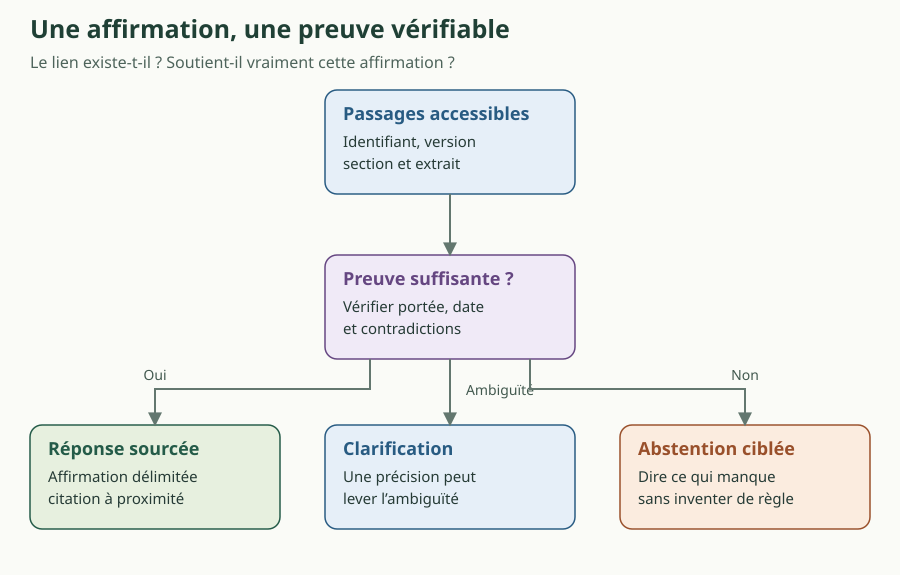

# Construire une réponse sourcée et une abstention

## Ce que tu sauras faire

Relier chaque affirmation à une preuve précise et décider quand répondre partiellement, demander une précision ou s'abstenir. Prérequis : [[Reranking et sélection des passages]].

> [!abstract] À retenir
> Une citation doit soutenir l'affirmation à laquelle elle est attachée. Afficher un lien réel ne suffit pas. L'abstention est une décision de l'application à évaluer, pas une formule magique dans le prompt.

## De la source à l'affirmation

Une réponse peut être fluide, factuellement correcte et pourtant mal citée. Inversement, elle peut reproduire fidèlement une procédure périmée et être incorrecte pour la situation actuelle. Distinguer **qualité de la source**, **fidélité à la preuve** et **validité de la réponse**.

Conserver un identifiant de passage, un document, une section ou page, une version et un extrait consultable. Faire produire au modèle des références parmi les identifiants fournis, puis vérifier côté application qu'elles existent et restent accessibles. Cette vérification mécanique ne prouve pas que l'extrait soutient réellement l'affirmation : une revue sémantique reste nécessaire.

## Exemple résolu : répondre sans compléter au hasard

Question fictive : « Les retours sont-ils possibles et le transport est-il remboursé ? » La source active S1 indique seulement « Retours sous 14 jours après réception ».

| Proposition de réponse | Diagnostic |
| --- | --- |
| Retours sous 14 jours et transport remboursé [S1] | La seconde affirmation est inventée |
| Retours sous 14 jours après réception [S1]. La source ne précise pas le remboursement du transport. | Réponse partielle délimitée |
| Aucun remboursement du transport n'est possible | L'absence de preuve devient à tort une interdiction |

> [!example] Rendre la limite utile
> « Le délai documenté est de 14 jours après réception [S1, section Retours]. Je ne peux pas établir la règle sur les frais de transport à partir des sources accessibles. » Proposer le service compétent ou une recherche complémentaire autorisée, sans présenter une hypothèse comme une règle.

## Choisir la bonne sortie

| Situation | Comportement attendu |
| --- | --- |
| Preuve actuelle, complète et applicable | Répondre avec une citation proche de l'affirmation |
| Produit ou date non précisés | Poser la question qui permet de choisir la règle |
| Une seule partie est prouvée | Répondre à cette partie et expliciter la limite |
| Sources actives contradictoires | Signaler le conflit et demander arbitrage |
| Preuve insuffisante | S'abstenir sur le point non établi |

Une bonne abstention n'affirme pas que l'information n'existe nulle part. Elle décrit ce que le système peut établir dans son périmètre. En présence de droits d'accès, éviter de révéler le titre ou l'existence d'un document interdit. Les sorties de refus suivent une politique explicite, vérifiée avec des utilisateurs de rôles différents.

> [!warning] Ne pas croire la confiance déclarée
> « Je suis sûr à 98 % » est du texte généré, pas une mesure validée. Une décision sensible doit reposer sur des preuves et des critères testés. Un seuil de similarité universel n'établit pas à lui seul que la question est répondable.

> [!tip] Tester deux erreurs opposées
> Inclure des questions avec preuve et des questions sans preuve. Mesurer les réponses non soutenues, mais aussi les abstentions inutiles. Un assistant qui refuse tout peut éviter l'invention tout en étant inutilisable.

## Exercice guidé : citation trompeuse

La phrase « Tous les clients disposent d'une assistance 24 h/24 [S2] » cite « Les clients Premium disposent d'une assistance 24 h/24 ». Corrige la réponse et indique le contrôle manquant.

> [!answer]- Correction
> Écrire « Les clients Premium disposent d'une assistance 24 h/24 [S2] ». Si le statut du client est inconnu, demander cette précision avant de conclure pour lui. Le lien peut être valide alors que la portée de l'affirmation dépasse la preuve : il manque un contrôle de soutien sémantique.

## Exercice autonome : deux versions

Un passage de 2024 dit 30 jours et un passage de 2026 dit 14 jours. Peut-on toujours choisir le plus récent ? Décris les informations nécessaires.

> [!answer]- Correction
> Non. Vérifier dates d'effet, périmètre de produits, catégorie de clients et version applicable à la transaction. Un contrat historique peut relever de l'ancienne règle. Si ces données manquent, demander une précision ; si deux règles applicables se contredisent, signaler le conflit plutôt que choisir arbitrairement.
>
> Réussite : distinguer date de publication et applicabilité, citer la règle retenue et expliciter l'incertitude restante.

## Sources et portée

Source consultée le 12 novembre 2026. Les cas et règles métier sont inventés. La grille de décision est une proposition pédagogique à adapter au produit.

- [Gao et al. — ALCE : évaluer correction et qualité des citations](https://arxiv.org/abs/2305.14627)

