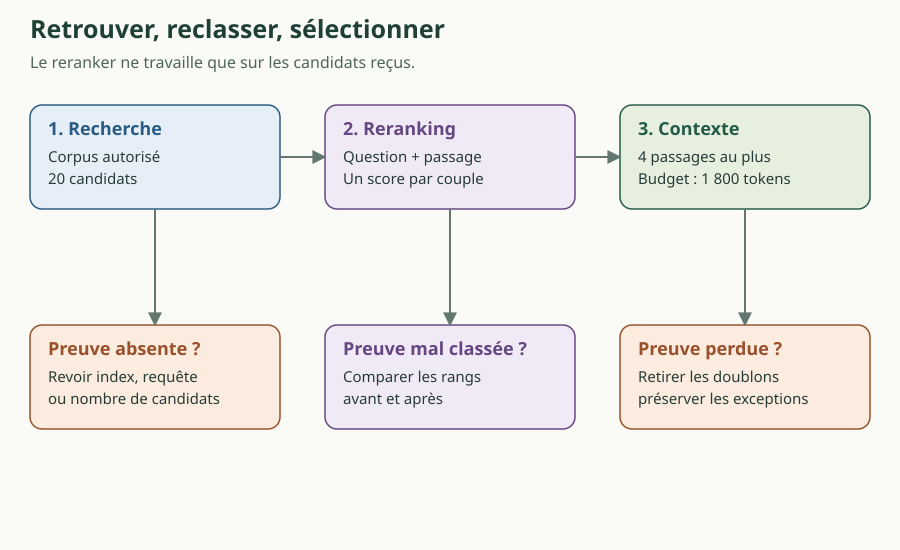

# Reranking et sélection des passages

## Ce que tu sauras faire

Séparer recherche de candidats, reclassement et composition du contexte. Diagnostiquer un passage absent et choisir un compromis de coût. Prérequis : [[Recherche lexicale, BM25 et recherche hybride]] et [[Gestion du contexte et budgets de tokens]].

> [!abstract] À retenir
> Le reranker compare plus finement la question aux passages déjà retrouvés. Il ne peut pas retrouver une preuve absente de ses candidats. Un bon rang ne garantit ni la vérité ni le droit de consulter une source.

## Deux étages, deux budgets

Un premier moteur cherche rapidement dans un grand corpus. Un **cross-encoder** peut ensuite lire ensemble la question et chaque passage candidat pour produire un score de pertinence. Contrairement aux embeddings précalculés séparément, cette comparaison dépend du couple question-passage : le travail est à refaire pour une nouvelle question.

| Étape | Exemple de budget fictif | Question de diagnostic |
| --- | --- | --- |
| Recherche initiale | 20 candidats autorisés | La preuve nécessaire est-elle présente ? |
| Reranking | 20 couples à comparer | La preuve remonte-t-elle ? |
| Sélection | Au plus 4 passages, 1 800 tokens | Les exceptions et versions sont-elles conservées ? |

Ces nombres servent à expérimenter, pas à prescrire une configuration universelle. Augmenter les candidats peut améliorer le rappel, mais augmente le travail du reranker. Mesurer séparément latence de recherche, reclassement et génération. Un petit modèle spécialisé peut suffire ; sa pertinence dans ta langue et tes documents doit être testée.

## Exemple résolu : le meilleur score ne suffit pas

Question fictive : « Une pièce personnalisée sans défaut est-elle reprise ? » Les passages A et B répètent la règle générale de retour. C porte l'exception sur les produits personnalisés. D est une ancienne version.

> [!example] Composer une preuve, pas une collection de doublons
> Après contrôle de la version, sélectionner la règle et C. Deux copies de la règle consomment le contexte sans apporter l'exception. Si C n'est pas dans les candidats, modifier la recherche ou le découpage ; changer uniquement le classement ne le fera pas apparaître.

Le score sert à ordonner les candidats selon le modèle. Son échelle dépend de l'implémentation ; même normalisé entre 0 et 1, il n'est pas automatiquement une probabilité calibrée que la réponse sera vraie. Un seuil doit être choisi sur des exemples annotés et réévalué quand le modèle ou le domaine change.

## Intégrer dans ton environnement

Dans un prototype local, le moteur de recherche et un reranker compatible peuvent tourner près de l'index ; le service de génération reçoit seulement les passages retenus. Ton accès à un gros LLM ne garantit pas qu'un endpoint de reranking existe. Vérifier les capacités du service, puis mesurer RAM, VRAM et latence de l'alternative locale. Ne pas envoyer de documents internes à un service externe pour faciliter le test.

> [!warning] Le filtrage reste obligatoire
> Appliquer les droits et la version active avant de transmettre les candidats à un composant non autorisé. Un score élevé ne permet jamais de contourner ces contrôles.

> [!tip] Comparaison utile
> Sur les mêmes questions et le même index, comparer recherche seule et recherche avec reranking. Compter les preuves présentes dans le contexte final, les réponses correctes et la latence au 95e percentile. Garder modèle générateur et prompt constants.

## Exercice guidé : preuve introuvable

La preuve apparaît au rang 37 du moteur initial. Ton reranker reçoit les 20 premiers candidats. Peut-il la placer dans les 4 passages finaux ? Propose deux leviers.

> [!answer]- Correction
> Non : il ne reçoit pas cette preuve. Élargir le nombre de candidats, en mesurant le surcoût, ou améliorer la recherche initiale : requête hybride, découpage et métadonnées. Vérifier d'abord que la source est indexée et accessible. Aucun réglage du reranker seul ne corrige son absence.

## Exercice autonome : budget serré

Budget de contexte documentaire : 900 tokens. A fait 500 tokens, B fait 450 et répète A, C fait 350 et contient l'exception indispensable. Toutes les sources sont autorisées et actuelles. Que sélectionner et comment tester ce choix ?

> [!answer]- Correction
> A + C utilisent 850 tokens et couvrent règle et exception. A + B dépasse le budget et reste incomplet. Vérifier le décompte avec le tokenizer réel, puis poser une question générale et une question sur l'exception. Le budget documentaire doit déjà exclure les instructions, la question et la réserve de sortie.
>
> Réussite : calculer le budget, éviter la redondance et tester la réponse finale, pas seulement le rang.

## Sources et portée

Source consultée le 12 novembre 2026. Scénarios et budgets pédagogiques fictifs ; aucune performance mesurée n'est annoncée.

- [Sentence Transformers — Retrieve & Re-Rank](https://www.sbert.net/examples/sentence_transformer/applications/retrieve_rerank/README.html)

