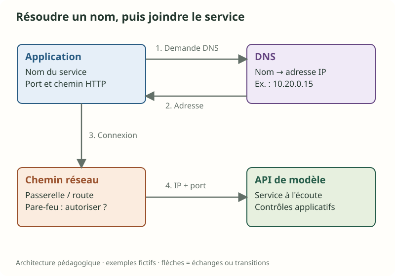

# Réseaux : IP, ports, DNS et routage

Prérequis : [[Comprendre une API de modèle]] ; [[Docker images conteneurs et services IA]].

## Ce que tu sauras faire

- Décomposer une adresse de service en nom, adresse IP, port et chemin.
- Distinguer un problème de réseau d'un problème de modèle.
- Expliquer ce que désigne **localhost** selon le composant qui fait l'appel.

> [!abstract] À retenir
> Un modèle peut fonctionner parfaitement tout en restant inaccessible à ton application. Avant de changer de modèle, identifier où la connexion s'arrête.

## Quatre notions, quatre responsabilités

| Notion | Question | Exemple fictif |
| --- | --- | --- |
| Adresse IP | Quelle interface réseau joindre ? | 10.20.0.15 |
| Port | Quel point d'entrée du service ? | 443 pour HTTPS par défaut |
| DNS | Quelle adresse correspond au nom ? | modele.example.test |
| Routage | Par quel chemin envoyer les paquets ? | Route directe ou passerelle |

Le **chemin HTTP**, par exemple `/v1/chat`, désigne une ressource de l'application. Il ne remplace ni l'adresse IP ni le port. Un nom peut résoudre vers plusieurs adresses ; un frontal peut distribuer les appels entre plusieurs serveurs. Les adresses ci-dessus sont pédagogiques et ne désignent aucune installation réelle.

> [!warning] Résoudre un nom ne suffit pas
> Une réponse DNS correcte ne prouve pas que le port est joignable. Une connexion établie ne prouve pas que l'utilisateur est autorisé ni que le modèle est prêt.

## Localhost dépend de celui qui parle

`127.0.0.1` est une adresse de boucle locale IPv4 ; `::1` joue ce rôle en IPv6. Dans une configuration Docker avec isolation réseau classique, le backend et l'index ont des espaces réseau distincts. Depuis le backend, `localhost` vise le backend lui-même, pas automatiquement le conteneur d'index ou l'hôte.

> [!example] Ton laboratoire
> Un navigateur appelle un backend sur le PC. Le backend appelle un index dans un autre conteneur et une API de modèle autorisée. Le navigateur n'a pas besoin de connaître l'adresse interne de l'index : c'est le backend qui doit pouvoir la joindre.

Sur un réseau Docker partagé, le nom du service peut servir à joindre l'index selon la configuration. Publier son port sur l'hôte n'est pas systématiquement nécessaire pour permettre la communication entre services. Relis [[Docker images conteneurs et services IA]] pour distinguer port interne et port publié.

## Diagnostiquer dans le bon ordre

| Symptôme | Première piste | Ce que cela ne démontre pas |
| --- | --- | --- |
| Nom introuvable | Nom, DNS, accès au réseau attendu | Que le modèle est défectueux |
| Connexion refusée | Service arrêté, mauvais port, rejet actif | Que les identifiants sont mauvais |
| Connexion qui expire | Filtrage, route, service ou réseau indisponible | Qu'une seule cause est certaine |
| Réponse HTTP 401 | Identifiants du service | Que le DNS a échoué |

> [!tip] Méthode
> Noter le composant appelant, le nom visé, le port, l'heure et l'erreur exacte. Vérifier ensuite résolution → connexion → TLS → HTTP → résultat métier. Ne pas confondre une hypothèse avec un diagnostic confirmé.

Dans un environnement interne, un nom peut ne fonctionner qu'avec le DNS et le réseau de l'entreprise. Être connecté à Internet ne prouve pas l'accès à cette zone. Les passages entre zones doivent être explicités dans [[Déployer une IA avec des données confidentielles]].

## Exercice : le service fonctionne, mais pas pour le backend

Un index écoute sur le port 6333 dans son conteneur. Le backend utilise `http://localhost:6333` et reçoit un refus. Les deux services sont prévus sur un même réseau Docker. Un collègue propose d'ouvrir tous les ports du poste.

- Explique l'erreur probable.
- Propose une correction limitée et une vérification.
- Le succès d'une connexion suffit-il à garantir l'accès aux bons documents ?

> [!answer]- Repères de correction
> **Erreur probable** : le backend cherche l'index dans son propre espace réseau. Vérifier cette hypothèse dans la configuration, car des modes réseau particuliers peuvent changer ce comportement.
>
> **Correction** : utiliser le nom du service d'index sur le réseau partagé et son port d'écoute, puis vérifier depuis le backend la résolution et une requête de santé documentée. Contrôler que l'index écoute sur une interface joignable dans ce réseau. Ouvrir tous les ports ne corrige pas l'adresse cible et élargit inutilement l'exposition.
>
> **Limite** : une connexion réussie ne valide pas l'authentification, les droits documentaires ni la pertinence de la recherche. Tester ces couches séparément.

## Sources et portée

Sources consultées le 12 novembre 2026. Architecture fictive ; aucune modification réseau ni requête vers tes serveurs n'est effectuée.

- [MDN — Fonctionnement d'Internet](https://developer.mozilla.org/en-US/docs/Learn_web_development/Howto/Web_mechanics/How_does_the_Internet_work)
- [Docker — Réseaux des conteneurs](https://docs.docker.com/engine/network/)
