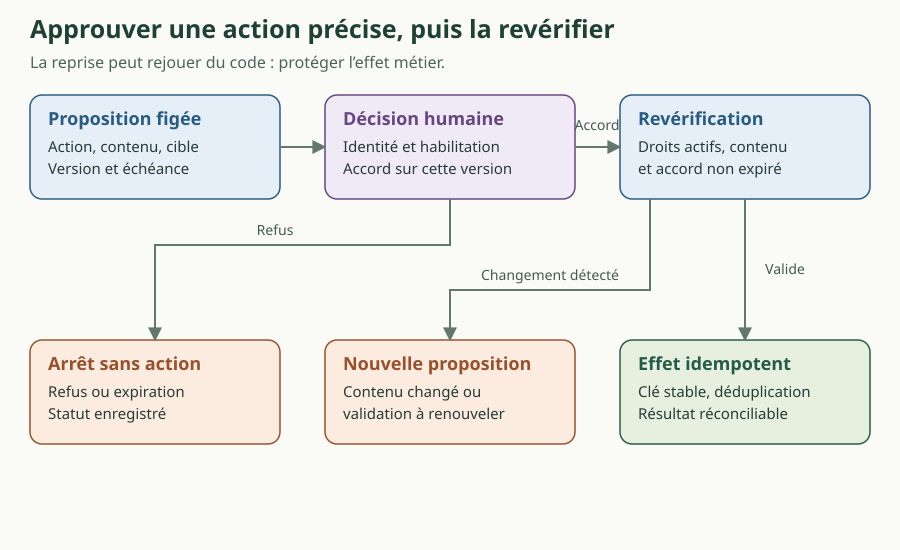

# Validation humaine et reprise d'une exécution

## Ce que tu sauras faire

Concevoir une validation portant sur une action précise, reprendre un workflow après une attente et empêcher les doublons. Prérequis : [[Files de messages, reprises et idempotence]] et [[Concevoir un contrat d'outil et un schéma JSON]].

> [!abstract] À retenir
> L'humain approuve une proposition déterminée, pas toutes les actions futures de l'agent. Après l'attente, vérifier à nouveau droits, version et validité. Une reprise après panne doit éviter de répéter l'effet métier.

## Une approbation est un état du système

Le modèle prépare une proposition ; le harness applique la politique qui décide si une revue est nécessaire. Persister l'état avant l'attente : identifiant d'exécution, proposition, version, auteur et statut. La réponse humaine est une entrée authentifiée que le serveur valide. Le texte « le responsable a approuvé » produit par le modèle ne constitue pas une approbation.

| Élément montré au relecteur | Pourquoi |
| --- | --- |
| Action et ressource exactes | Comprendre l'effet métier |
| Destinataire, contenu et pièces jointes | Vérifier ce qui va être transmis |
| Sources et incertitudes | Contrôler le raisonnement utile |
| Version et échéance | Éviter une approbation périmée |
| Options approuver, corriger, refuser | Permettre une décision réelle |

La page doit rendre les différences importantes visibles. Une case « j'accepte » au milieu de centaines de lignes encourage la validation mécanique. Mesurer aussi le temps de revue, les corrections et les faux positifs : un dispositif trop bruyant finit par être ignoré.

## Exemple résolu : un message de support

L'agent prépare un message de réponse pour le ticket fictif T-42. La proposition v1 vise le contact A. Le relecteur l'approuve, puis une nouvelle donnée fait passer le destinataire à B.

> [!example] L'accord ne se transfère pas
> La version v1 approuvée ne couvre pas le destinataire B. Créer une proposition v2 et demander une nouvelle revue selon la politique. Lier la décision à un identifiant de version ou une empreinte du contenu canonique, conservés côté serveur. Une empreinte vérifie l'identité du contenu ; elle n'authentifie pas à elle seule le relecteur.

## Reprendre sans exécuter deux fois

Dans un moteur durable, une reprise peut rejouer une partie du traitement. Avec les interruptions LangGraph, le nœud interrompu redémarre : les effets placés avant l'interruption peuvent donc être répétés. Même après approbation, une panne entre l'action et l'enregistrement du succès crée un risque de doublon.

Utiliser une clé d'idempotence stable pour la même action approuvée, avec déduplication atomique dans le système qui applique l'effet lorsque c'est possible. Si le service distant ne supporte ni idempotence ni vérification fiable, un statut incertain exige une réconciliation ou une revue : ne pas relancer aveuglément.

> [!warning] Une attente ne vaut pas un accord
> L'expiration, l'absence de réponse ou une perte de connexion ne doivent pas devenir une approbation implicite. Appliquer une politique explicite d'expiration et d'escalade. Revérifier les permissions au moment de l'action, car elles peuvent avoir changé pendant l'attente.

> [!tip] Tester les frontières
> Simuler refus, expiration, modification après accord, double clic et panne après effet métier. Vérifier l'état final et le nombre d'effets réels, pas uniquement le message « succès » dans l'interface.

## Exercice guidé : panne au mauvais moment

Le serveur distant a créé le ticket, mais ton worker s'arrête avant d'enregistrer le succès. À la reprise, faut-il générer une nouvelle clé d'idempotence pour retenter la même action ?

> [!answer]- Correction
> Non. Réutiliser la clé de l'action déjà approuvée permet au destinataire de reconnaître un doublon si son API le prend en charge. Récupérer le résultat existant ou réconcilier le statut. Une nouvelle clé ferait passer la tentative pour une nouvelle action. Une simple vérification locale suivie d'une écriture distante ne garantit pas l'absence de course ou de doublon.

## Exercice autonome : droit retiré

Une responsable approuve la proposition à 9 h. À 9 h 10, son rôle de validation est retiré. L'action reprend à 9 h 20. La politique exige une habilitation active à l'exécution. Décris la décision et les traces utiles.

> [!answer]- Correction
> Bloquer l'exécution avec cette approbation devenue insuffisante. Demander une validation à une personne actuellement habilitée, sans élargir automatiquement les droits de l'agent. Conserver identifiants de proposition et d'exécution, version, auteur, dates, résultat de contrôle et motif de blocage. Limiter les données personnelles et le contenu sensible dans les traces.
>
> Réussite : appliquer la politique annoncée à la reprise, distinguer accord historique et permission actuelle, ne produire aucun effet métier avant résolution.

## Sources et portée

Source consultée le 12 novembre 2026. L'exemple LangGraph illustre le rejeu ; les principes de validation restent applicables à d'autres moteurs. Les politiques de revue proposées sont fictives.

- [LangGraph — Interruptions, reprise et effets idempotents](https://docs.langchain.com/oss/python/langgraph/interrupts)

