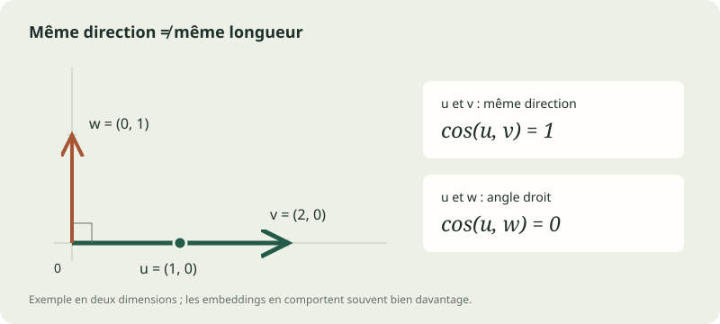

# Vecteurs matrices et similarité

## Ce que tu sauras faire

- Lire les **dimensions** d'un tenseur.
- Calculer une transformation matricielle.
- Interpréter une **similarité cosinus** et diagnostiquer un index incompatible.

> [!abstract] L'idée en une phrase
> Les vecteurs représentent, les matrices transforment et la similarité compare. Ces opérations sont au cœur des réseaux de neurones et de la recherche documentaire.

Cette fiche prépare [[Comprendre le Transformer et son attention]] et approfondit [[Embeddings et RAG documentaire]].

## Lire les nombres et leurs dimensions

| Objet | Organisation | Exemple | Usage en IA |
| --- | --- | --- | --- |
| Scalaire | Une valeur | 3 | Une perte |
| Vecteur | Un axe | (2, 1, 0) | Une représentation de token |
| Matrice | Deux axes | 2 lignes × 3 colonnes | Un lot de deux vecteurs |
| Tenseur | Un nombre quelconque d'axes | Forme (2, 5, 4) | Lot × tokens × dimensions |

Un lot de **2 séquences**, chacune de **5 tokens**, avec **4 valeurs** par token possède 2 × 5 × 4 = **40 valeurs**. Chaque axe a un rôle qu'il faut nommer avant de calculer.

> [!warning] Une coordonnée n'est pas une étiquette
> Dans un embedding appris, une dimension n'est généralement pas une catégorie lisible telle que « mécanique » ou « finance ». Le sens se distribue dans la représentation.

## Transformer : le produit matriciel

On multiplie chaque **ligne de X** par chaque **colonne de W**. Les dimensions intérieures doivent être identiques ; les dimensions extérieures donnent la forme du résultat.

> [!formula] Règle des dimensions
> (n × d) · (d × m) → (n × m)

*n* est le nombre de lignes d'entrée, *d* la dimension d'entrée, *m* la dimension de sortie. Il s'agit d'un produit matriciel, pas d'une multiplication case par case.

### Exemple résolu : de deux entrées à deux sorties

Prenons X = (2, 1). La matrice W contient deux lignes : (1, 3), puis (4, 0).

| Sortie | Colonne de W | Calcul ligne × colonne | Résultat |
| --- | --- | --- | --- |
| Première | (1, 4) | 2 × 1 + 1 × 4 | **6** |
| Seconde | (3, 0) | 2 × 3 + 1 × 0 | **6** |

:::formula matrix

Une couche peut ensuite ajouter un **biais** et appliquer une **fonction non linéaire**. Sans non-linéarités, empiler des transformations linéaires équivaut encore à une transformation linéaire.

## Comparer : une direction plutôt qu'une longueur

Le **produit scalaire** additionne les produits des coordonnées correspondantes. La **norme euclidienne** mesure la longueur. Pour deux vecteurs non nuls, la similarité cosinus normalise le produit scalaire par leurs longueurs.

:::formula dot

:::formula norm

:::formula cosine

*uᵢ* et *vᵢ* désignent la coordonnée numéro *i*. Le symbole ‖u‖ désigne la norme de *u*. La somme porte sur toutes les coordonnées.

| Vecteurs comparés | Produit scalaire | Produit des normes | Cosinus |
| --- | --- | --- | --- |
| (1, 0) et (2, 0) | 2 | 1 × 2 = 2 | **1** : même direction |
| (1, 0) et (0, 1) | 0 | 1 × 1 = 1 | **0** : orthogonaux |
| (1, 0) et (−1, 0) | −1 | 1 × 1 = 1 | **−1** : opposés |

> [!warning] Un score ne prouve pas une vérité
> Un cosinus élevé indique une proximité dans cet espace. Il ne garantit ni identité des textes, ni exactitude factuelle. Pour un vecteur nul, la formule est indéfinie : le logiciel doit traiter ce cas explicitement.

## Manipuler les directions

:::lab vectors

## Exercice guidé : compléter le calcul

Pour u = (1, 0) et v = (3, 0), le produit scalaire vaut 3. Complète : norme de u = … ; norme de v = … ; cosinus = … . Que devient le cosinus si v devient (6, 0) ?

> [!answer]- Correction
> Les normes valent 1 et 3. Le cosinus vaut 3 / (1 × 3) = **1**. Avec (6, 0), produit scalaire et norme de v doublent : le cosinus reste **1**. La direction est inchangée.

## Appliquer : diagnostiquer un index incompatible

Un index contient des vecteurs de **768 valeurs**. Une nouvelle API renvoie **1 024 valeurs**. La comparaison n'est pas définie telle quelle : les dimensions diffèrent.

Même avec deux modèles de dimension identique, les espaces peuvent être incompatibles. Conserve avec l'index le **modèle**, sa **version** et la **préparation du texte**.

> [!tip] Réflexe d'intégration
> Vérifier les dimensions et la provenance → réencoder le corpus avec le nouveau modèle si nécessaire → mesurer la qualité de recherche sur des questions de référence avant la bascule.

## Exercice : calcul et diagnostic

- **A.** Calcule le produit scalaire, les deux normes et le cosinus de a = (1, 1) et b = (1, −1).
- **B.** Donne la forme du produit d'une matrice (10, 4) par une matrice (4, 3). Combien de valeurs contient le résultat ?
- **C.** Peut-on multiplier directement (10, 4) par (5, 3) ? Justifie.
- **D.** Pourquoi tronquer un vecteur de 1 024 à 768 valeurs ne suffit-il pas à valider une migration ?

> [!answer]- Repères de correction
> **A — Produit scalaire** : 1 × 1 + 1 × (−1) = 0. Chaque norme vaut √(1² + 1²) = √2. Le cosinus vaut donc 0 / (√2 × √2) = **0**. Les vecteurs sont orthogonaux.
>
> **B — Dimensions** : les dimensions intérieures valent 4, le produit est défini. Les dimensions extérieures donnent **(10, 3)**, soit **30 valeurs**.
>
> **C — Incompatibilité** : les dimensions intérieures 4 et 5 diffèrent. Ce produit matriciel n'est pas défini ; changer seulement l'étiquette des axes ne corrige pas les données.
>
> **D — Migration** : tronquer change la représentation sans garantir que ses coordonnées correspondent à celles de l'ancien modèle. Certains modèles sont spécifiquement entraînés pour une réduction de dimension, mais cela ne rend pas deux modèles interchangeables. Vérifier la méthode supportée, réencoder le corpus si nécessaire et comparer la recherche sur un jeu de référence.
>
> **Autoévaluation** : un point par réponse, avec calcul ou justification. Revoir les dimensions si B ou C est faux, le cosinus si A est faux, et la provenance des embeddings si D est faux.

## Sources et portée

Sources consultées le 12 novembre 2026. Calculs et schéma originaux ; dimensions pédagogiques. Cette fiche couvre les opérations de base, pas une théorie complète de l'algèbre linéaire.

- [NumPy — Produit matriciel](https://numpy.org/doc/stable/reference/generated/numpy.matmul.html)
- [scikit-learn — Similarité cosinus](https://scikit-learn.org/stable/modules/generated/sklearn.metrics.pairwise.cosine_similarity.html)
- [OpenStax — Matrices and Matrix Operations](https://openstax.org/books/algebra-and-trigonometry-2e/pages/11-5-matrices-and-matrix-operations)
